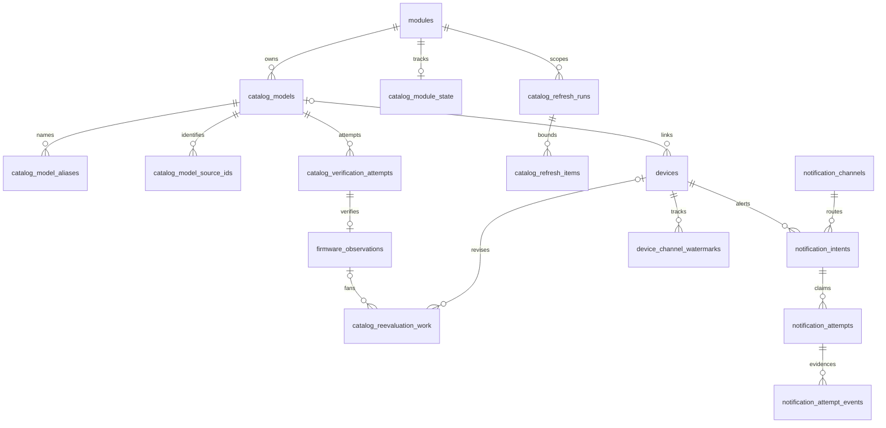

# Data Model: Catalog Persistence and Write Ownership

## Entities and Constraints

| Entity | Attributes (name: type, constraints) | Relationships | State Transitions |
|--------|--------------------------------------|---------------|-------------------|
| Storage conventions | Migration: `backend/src/binocular/db/migrations/0011_catalog_foundation.sql`. Below, unmarked fields are `NOT NULL`; `?` means nullable; `U` = UUID serialized as canonical lowercase TEXT, validated by typed repository; `T` = INTEGER UTC epoch milliseconds `CHECK(value>=0)`; `N` = INTEGER `CHECK(value>=0)`; `P` = INTEGER `CHECK(value>0)`; boolean = INTEGER `CHECK(value IN(0,1))`. String enums use SQL CHECK. Nonempty text uses `CHECK(length(trim(value))>0)`. All foreign keys are immediate; delete action RESTRICT unless specified. New JSON text uses `CHECK(json_valid(value))`, typed shape validation, and a stated length bound. | Existing INTEGER IDs, timestamp formats and columns remain unchanged. New records use typed frozen dataclasses and Literal enums, not unvalidated dictionaries. | No production activation of new work. |
| Additive migration | Only CREATE TABLE/INDEX/TRIGGER, ALTER ADD COLUMN and explicit backfill UPDATE; no device/module rebuild, DROP, historical-script edit or fabricated catalog/intent/attempt rows. Add columns with literal defaults acceptable to SQLite. Install triggers **after** backfill. Back up successfully before upgrade; runner executes all pending scripts and `PRAGMA user_version=<final>` inside one explicit transaction in a single executescript submission; rollback on error, including earlier pending scripts. No per-script commit, network or VACUUM inside transaction. | Preserve `modules`, `devices`, `schedules`, `notification_channels`, `activity_log`, `canon_firmware_endpoint_mappings`, `canon_refresh_leases` and existing triggers/data. Empty/populated/reopen/failed-backup/failed-late-statement tests required. | Fatal backup/migration failure leaves original schema/data/version. |
| Module / CatalogState | Add `modules.config_generation: P DEFAULT 1`. New `catalog_module_state`: `module_id: INTEGER PK`, `next_run_generation: P DEFAULT 1`, `enumeration_last_attempt_id: U?`, `enumeration_last_success_at: T?`, `enumeration_last_success_generation: P?`; CHECK last-success pair both null or both nonnull. Last attempt points to a same-module, module-scope refresh run, enforced by trigger. No state row required for V1 modules. | module_id → modules ON DELETE CASCADE; enumeration_last_attempt_id → catalog_refresh_runs. Existing health `last_success` is not enumeration or model verification success. Existing schedule frequency/pause representation remains untouched. | Increment config_generation on comparison/refresh-relevant module replacement/configuration/control changes, not health timestamps. Conditional completions require captured generation. |
| CatalogModel (`catalog_models`) | `id: U PK`, `module_id: INTEGER`, `source_model_key: TEXT nonempty`, `variant_key: TEXT` canonical JSON, length≤2048, `display_name: TEXT nonempty length≤240`, `source_url: TEXT? length≤2048`, `presence: TEXT DEFAULT 'active' CHECK IN('active','missing')`, `last_seen_at: T`, `last_seen_generation: P`, `observation_generation: N DEFAULT 0`, `identity_verified_at: T?`, `identity_evidence_url: TEXT? length≤2048`, `identity_evidence_kind: TEXT? CHECK IN('authoritative_listing','authoritative_detail')`, `identity_evidence_digest: TEXT?` lowercase SHA-256 CHECK length=64/no nonhex. Identity evidence quartet all null or all present. UNIQUE(module_id,source_model_key,variant_key); UNIQUE(id,module_id). Index(module_id,presence,display_name,id). Variant shape exactly `{region: str|null,mount: str|null,hardware_revision: str|null,extra: object[str,str|null]}`, sorted compact JSON, normalized by versioned `canonical_variant_v1`, no omitted dimensions. Null means exact unspecified, not wildcard. | module_id → modules. Source key/variant/module/id immutable by trigger; renamed display text retains UUID. Referenced missing models retained. Identity evidence must attest this exact tuple; firmware outcome alone cannot populate it. | active ↔ missing only on complete authoritative **module-scope enumeration**, never failed/partial/model-only runs. last_seen advances for actual sightings; complete scan marks only unseen models from that module missing. |
| Alias / SourceIdentifier (`catalog_model_aliases`, `catalog_model_source_ids`) | Aliases: `model_id: U`, `alias: TEXT nonempty length≤240`, `search_key: TEXT nonempty length≤480`; PK(model_id,alias), index(search_key,model_id). Source IDs: `model_id: U`, `namespace: TEXT nonempty length≤120`, `value: TEXT nonempty length≤512`, `source_url: TEXT? length≤2048`; PK(model_id,namespace,value), index(namespace,value,model_id). Search normalization is metadata only; prefix-key queries bounded to ≤100 rows, default 50. | model_id → catalog_models ON DELETE CASCADE. Duplicate aliases/secondary source IDs across models are allowed; never merge variants on them. Stable authoritative identity remains catalog_models' unique tuple. | Rename may retain old display as alias. Source-ID additions do not rekey model. |
| Device (existing `devices`) | Add `catalog_model_id: TEXT? REFERENCES catalog_models(id) ON DELETE RESTRICT DEFAULT NULL`, `catalog_link_state: TEXT DEFAULT 'legacy' CHECK IN('legacy','unresolved','linked')`, `installed_unknown: boolean DEFAULT 1`, `revision: P DEFAULT 1`, `comparison_status: TEXT DEFAULT 'unverified' CHECK IN('unverified','unknown','comparison_unknown','current','update_available','no_firmware','stale','failed')`. Backfill installed_unknown=1 iff current_version.strip()==''; otherwise 0; preserve current_version byte-for-byte. Set comparison_status='unknown' and has_update=0 for unknown rows. SQL whitespace predicate uses trim with `char(9,10,11,12,13,28,29,30,31,32,133,160,5760,8192,8193,8194,8195,8196,8197,8198,8199,8200,8201,8202,8232,8233,8239,8287,12288)` to agree with Python str.strip. Index(catalog_model_id,id). | Keep existing module_id FK and `model` text. Insert/update triggers require `(catalog_model_id IS NOT NULL) = (catalog_link_state='linked')`, same module ownership, nonnull model identity evidence for linking, and nonblank current_version if installed_unknown=0. Trigger on catalog_models rejects ownership/identity-key mutation and clearing identity evidence while linked. SQLite ADD COLUMN cannot add the desired composite FK, so simple FK + ownership triggers are mandatory, not an unsupported ALTER ADD CONSTRAINT. | Explicit unknown wins over retained text. Nonblank installed input clears unknown unless explicitly unknown; blank becomes unknown. CAS expected revision; relevant installed/unknown/module/model/link/confirmation mutation sets revision=old+1, check/status/watermark writes leave it unchanged. Guard trigger rejects relevant changes without +1 and other jumps except explicit +1 confirmation. No trigger enqueues dormant work. |
| CanonicalVariant / IdentityEvidence (typed values) | `canonical_variant_v1`: NFC-normalize then trim supplied component strings, reject empty strings (caller uses null for unspecified), preserve case and punctuation, sort extra keys, reject extra keys colliding after normalization, serialize all four named fields with sorted keys/compact separators/UTF-8 JSON. Region/mount/hardware null values are mandatory explicit fields; extra defaults to empty object. Source key is opaque exact nonblank text: no Unicode normalization, case folding or trimming for comparison; whitespace-only is rejected. Omitted required variant dimensions are invalid, not inferred/wildcards; null matches only null. Evidence carries exact module/source key/canonical variant plus authoritative URL, response digest, verification time and listing/detail method. | Repository validates evidence tuple equality before persisting identity quartet; resolving requires supplied evidence tuple to match the stored verified tuple. Firmware success without independent identity evidence is insufficient. | Canonicalizer version is fixed for this schema; future changes require explicit migration, never implicit rekey. |
| Exact identity resolver (typed contract) | Input `VerifiedIdentity(module_id:int, source_model_key:str, variant:CanonicalVariant, evidence:IdentityEvidence)`; verify authoritative evidence covers exact tuple, query exact unique tuple with stored evidence, and return `Resolved(model_id)` only for one match. Else `Unresolved(reason)`; alias/name/firmware-success inputs are not accepted as proof. Link mutation CASes device revision/module and changes link state in same write unit. `unresolved` records an attempted-but-unproven link; untouched migration/manual V1 rows remain `legacy`. | Evidence fields live on catalog_models, not synthesized from old device.model. All cross-module links fail at SQL boundary. | No offline backfill matches; no guessed catalog rows. |
| VerificationAttempt (`catalog_verification_attempts`) | `id: U PK`, `model_id: U`, `run_id: U?`, `config_generation: P`, `started_at: T`, `finished_at: T?`, `outcome: TEXT CHECK IN('running','firmware','no_firmware','unsupported','failed','cancelled')`, `error_code: TEXT? length≤120`, `error_detail: TEXT? length≤2000`; CHECK running iff finished_at IS NULL; CHECK finished_at IS NULL OR finished_at>=started_at; CHECK failed/unsupported require error_code. UNIQUE(id,model_id), index(model_id,started_at DESC,id). run/model ownership trigger. | model_id → catalog_models; run_id → catalog_refresh_runs. Latest attempt query independent of latest successful observation; attempts are never inferred from enumeration. | running → firmware/no_firmware/unsupported/failed/cancelled, one terminal transition. Interrupted running attempt records cancellation/failure without touching observation. |
| FirmwareObservation (`firmware_observations`) | `id: U PK`, `model_id: U`, `generation: P`, `attempt_id: U UNIQUE`, `kind: TEXT CHECK IN('firmware','no_firmware')`, `version_display: TEXT? length≤240`, `version_key: TEXT? length≤512`, `verified_at: T`, `provenance_url: TEXT nonempty length≤2048`, `provenance_digest: TEXT` SHA-256, `release_url: TEXT? length≤2048`, `release_notes: TEXT? length≤10000`; CHECK firmware iff both version fields nonnull/nonblank; no_firmware requires both null. UNIQUE(model_id,generation), UNIQUE(id,model_id,generation). Immutable by update/delete triggers. Attempt/model FK plus trigger requires matching terminal outcome, authoritative identity-matching evidence and captured current config/run fence. | model_id → catalog_models; (attempt_id,model_id) → catalog_verification_attempts(id,model_id). No endpoint-cache FK. Latest success = highest generation, timestamp comes only from actual verified response. | Atomically increment model.observation_generation, insert matching observation and model reevaluation work. Failed/unsupported attempts create no observation and never advance generation/verified_at. Freshness derived at read: age < module interval and eligible latest attempt; pause shown separately. |
| RefreshRun (`catalog_refresh_runs`) | `id: U PK`, `module_id: INTEGER`, `generation: P`, `config_generation: P`, `scope_key: TEXT nonempty length≤128` (`module` or `model:<uuid>`), `model_id: U?`, `state: TEXT CHECK IN('queued','running','complete','partial','failed','cancelled','obsolete')`, `created_at: T`, `deadline_at: T CHECK(deadline_at>created_at)`, `max_requests: P`, `requests_used: N DEFAULT 0 CHECK(requests_used<=max_requests)`, `max_models: P`, `models_used: N DEFAULT 0 CHECK(models_used<=max_models)`, `cursor: TEXT? length≤8192`, `enumeration_complete: boolean DEFAULT 0`, `authoritative: boolean DEFAULT 0`, `last_progress_at: T?`, `finished_at: T?`, `error_code: TEXT? length≤120`, `error_detail: TEXT? length≤2000`, `claim_token: U?`, `claim_generation: N DEFAULT 0`, `owner_instance: U?`, `lease_until: T?`. Claim triple token/owner/lease all null or all present; UNIQUE(module_id,generation); partial UNIQUE(module_id,scope_key) WHERE state IN('queued','running'); index(state,deadline_at). CHECK scope_key='module' iff model_id IS NULL; model scope exact string checked by trigger. CHECK terminal iff finished_at nonnull; complete requires enumeration_complete=1 for module scope. | module_id → modules; model_id → catalog_models with ownership trigger. Generation allocated by CAS of catalog_module_state.next_run_generation; does not reset on restart. Enumeration attempt metadata is the run; successful enumeration last-success pair updates only on authoritative complete module enumeration, independently of firmware results. | queued → running → complete/partial/failed/cancelled/obsolete. No terminal reopening or budget reset. Resume running only before deadline with fenced new lease; exhaustion/deadline terminates partial if progress, failed otherwise. |
| Enumeration metadata (additional RefreshRun columns) | `enumeration_outcome: TEXT DEFAULT 'not_requested' CHECK IN('not_requested','running','complete','partial','failed','cancelled')`, `enumeration_started_at: T?`, `enumeration_finished_at: T?`, `enumeration_error_code: TEXT? length≤120`, `enumeration_error_detail: TEXT? length≤2000`; CHECK enumeration_complete=1 iff enumeration_outcome='complete'; CHECK not_requested requires null enumeration timestamps, running requires start/nonfinished, terminal outcomes require start/finish with finish>=start. Trigger restricts model-scope runs to not_requested. | Separate enumeration outcome from overall run state and per-model attempt outcomes: successful authoritative enumeration may coexist with overall partial firmware run. Every module-scope enumeration start records last_attempt_id; successful enumeration updates last-success independently. | not_requested → running → complete/partial/failed/cancelled. No missing marking unless complete **and** authoritative, even if overall run otherwise succeeds. |
| RefreshItem (`catalog_refresh_items`) | `run_id: U`, `model_id: U`, `state: TEXT CHECK IN('queued','running','verified','no_firmware','failed','cancelled','obsolete')`, `deadline_at: T`, `max_requests: P`, `requests_used: N DEFAULT 0 CHECK(requests_used<=max_requests)`, `attempt_id: U?`, `error_code: TEXT? length≤120`; PK(run_id,model_id), index(run_id,state,model_id). Trigger requires same module and deadline≤run deadline; admission rejects >max_models. | run_id → catalog_refresh_runs; model_id → catalog_models; attempt_id → catalog_verification_attempts, same-model checked. Claim inherited from run, never independently authorizes stale work. | queued → running → verified/no_firmware/failed/cancelled/obsolete. Before **every** network attempt reserve run+item request consumption in short unit; crash may waste budget but cannot replenish it. Bounded chunk writes item effects, cursor and counters under run token/config/generation CAS together. |
| ReevaluationWork (`catalog_reevaluation_work`) | `id: U PK`, `kind: TEXT CHECK IN('model','device')`, `model_id: U?`, `observation_generation: P?`, `device_id: INTEGER?`, `device_revision: P?`, `state: TEXT CHECK IN('pending','running','complete','failed','obsolete')`, `cursor_device_id: N DEFAULT 0`, `chunk_limit: P CHECK(chunk_limit<=100)`, `max_chunks: P`, `chunks_used: N DEFAULT 0 CHECK(chunks_used<=max_chunks)`, `created_at: T`, `deadline_at: T CHECK(deadline_at>created_at)`, `finished_at: T?`, `error_code: TEXT? length≤120`, `claim_token: U?`, `claim_generation: N DEFAULT 0`, `owner_instance: U?`, `lease_until: T?`; same claim triple/terminal-time checks. CHECK model-kind has model/generation and null device/revision; device-kind has device/revision and null model/generation. Partial UNIQUE(model_id,observation_generation) WHERE kind='model'; UNIQUE(device_id,device_revision) WHERE kind='device'; index(state,deadline_at). | (model_id,observation_generation) → firmware_observations(model_id,generation); device_id → devices ON DELETE CASCADE. Model chunk scans linked devices `id>cursor ORDER BY id LIMIT chunk_limit`; current revision/observation reread in transaction. Separate device-revision work covers concurrent adds/edits below cursor. | pending → running → complete/failed/obsolete. Chunk effects, intent insertions, consumption and cursor CAS commit together. Obsolete work may finish only if current successor work exists or current state already evaluated; never drop required reevaluation. Exhaustion is visible failed, not infinite restart. |
| Channel (existing `notification_channels`) | Preserve INTEGER AUTOINCREMENT `id` as stable channel identity, existing unique type/config/enabled and all rows. Add `config_revision: P DEFAULT 1`; increment on effective config/enabled changes. Save uses UPDATE/upsert preserving id, never REPLACE/delete-and-insert. Future removal disables retained channel. | Intents/watermarks reference notification_channels.id RESTRICT, not mutable type/address/config text or credentials. Config JSON is not copied into attempt evidence. | V1 dispatch remains direct; new intent path dormant. |
| NotificationIntent (`notification_intents`) | `id: U PK`, `device_id: INTEGER`, `target_display: TEXT nonempty length≤240`, `target_key: TEXT nonempty length≤512`, `channel_id: INTEGER`, `observation_id: U`, `expected_device_revision: P`, `state: TEXT DEFAULT 'pending' CHECK IN('pending','sending','delivered','failed','uncertain','superseded')`, `created_at: T`, `updated_at: T`, `next_attempt_at: T?`, `claim_token: U?`, `claim_generation: N DEFAULT 0`, `owner_instance: U?`, `lease_until: T?`, `delivered_at: T?`, `error_code: TEXT? length≤120`; UNIQUE(device_id,target_key,channel_id), UNIQUE(id,claim_generation). Claim triple all null or all present; CHECK sending requires claim; CHECK delivered iff delivered_at IS NOT NULL. Index(state,next_attempt_at,id). Target/channel/device identity immutable; delivered state terminal by trigger. | device_id → devices ON DELETE RESTRICT; channel_id → notification_channels; observation_id → firmware_observations. Insert validates observation model matches currently linked device, canonical target matches observation and revision matches. Device deletion must retain delivery evidence by tombstoning device or be explicitly rejected once new intents exist; E032 V1 deletion unaffected because intents remain empty in production. | See state machine. Unique conflict returns existing identity, never resets delivered/uncertain or silently schedules retry. Channel-specific success independent of legacy devices.last_notified_version. |
| NotificationAttempt (`notification_attempts`) | Append-only claim header: `id: U PK`, `intent_id: U`, `claim_generation: P`, `claim_token: U UNIQUE`, `owner_instance: U`, `expected_device_revision: P`, `observation_id: U`, `channel_config_revision: P`, `claimed_at: T`, `lease_until: T CHECK(lease_until>claimed_at)`, `retry_kind: TEXT CHECK IN('initial','definite_failure','expired_unstarted','explicit_uncertain')`, `duplicate_risk_ack_at: T?`; UNIQUE(intent_id,claim_generation); CHECK ack nonnull iff explicit_uncertain, ack≤claimed_at. No UPDATE/DELETE, SQL triggers enforce. | intent_id → notification_intents; observation_id → firmware_observations. Header creation and intent claim CAS atomic. Header retains original token/revision even after intent claim changes. | Acquisition does not authorize dispatch. Exactly one token-checked pending/failed → sending transition appends send_authorized event and returns authorization; a repeated call returns false. |
| AttemptEvidence (`notification_attempt_events`) | Append-only `id: INTEGER PK AUTOINCREMENT`, `attempt_id: U`, `kind: TEXT CHECK IN('send_authorized','accepted','definite_failure','uncertain','owner_stopped','late_accepted','late_failure')`, `recorded_at: T`, `detail: TEXT? length≤2000`, `receipt_id: TEXT? length≤512`; partial UNIQUE(attempt_id) WHERE kind='send_authorized'; index(attempt_id,id). No UPDATE/DELETE, SQL triggers enforce. Repository validates allowed event ordering and strips secrets. | attempt_id → notification_attempts. Immutable evidence may be appended by original stale token; it cannot finalize current intent or advance current watermark. Any accepted/late_accepted evidence prevents subsequent automatic claim. | Interrupted/expired sending appends uncertain; stopping an original owner is recorded separately. Acceptance means provider acceptance, not human receipt/exactly-once. |
| ChannelWatermark (`device_channel_watermarks`) | `device_id: INTEGER`, `channel_id: INTEGER`, `target_key: TEXT nonempty length≤512`, `target_display: TEXT nonempty length≤240`, `accepted_at: T`, `attempt_id: U`; PK(device_id,channel_id). | device_id → devices RESTRICT; channel_id → notification_channels; attempt_id → notification_attempts. Advance only with current fenced accepted transition and supported comparator-proven newer target; all accepted event history remains even if revision fence disallows projection. Legacy aggregate watermark never backfills this table. | Confirmation never resets accepted history. One successful channel cannot suppress another failed channel. |
| VersionKey (typed value) | One `canonical_version_v1` shares `services/version_compare.py` token equality: strip whitespace and existing case-insensitive leading `version/ver/v` prefix; supported structured numeric versions with optional alphabetic suffix serialize compact JSON of existing parsed `(numeric,int)/(alpha,lowercase)` tokens, prefixed `tokens-v1:`. Preserve token count: 1.02 and 01.2 share key; **1.2 and 1.2.0 do not**, matching current comparator. No new trailing-zero equivalence. Supported grammar after prefix removal: `[0-9]+(?:[._-][0-9]+)*(?:[._-]?[A-Za-z]+(?:[._-]?[0-9]+)?)?` (ASCII digits). Unsupported strings use `opaque-v1:<exact original text>` with no case folding/guessed ordering. Display retained unchanged. | Same value contract for observation.version_key, intent.target_key and channel watermark. Opaque equality deduplicates exact text but cannot prove newer/current or enqueue alerts. Existing lexical/over-tolerant fallback is ineligible for proven comparison, yielding comparison_unknown. | Tests assert comparator equality iff equal canonical keys within supported domain, including existing prefix/suffix/zero-padding fixtures; semantics versioned, no silent key migration. |
| UnitOfWork / typed repositories | `WriteUnit` owns dedicated connection, `foreign_keys=ON`, WAL, busy_timeout=5000, BEGIN IMMEDIATE; exactly one explicit commit, rollback on pre-submission error/cancellation and close on all exits. Once commit queued, drain completion and establish durable result before close; cancellation may mean committed, never report fabricated rollback. Repository methods accept bound unit/connection; no internal commit/rollback, ambient shared writer or network. Typed records: CatalogModelRecord, IdentityEvidence, DeviceSnapshot, VerificationAttemptRecord, FirmwareObservationRecord, RefreshRunRecord, RefreshItemRecord, ReevaluationWorkRecord, NotificationIntentRecord, NotificationAttemptRecord, AttemptEventRecord; typed Claimed/Conflict/Exhausted/Uncertain results. | `catalog_repository.py`: upsert metadata/aliases/source IDs, exact resolver, enumeration completion; `observation_repository.py`: start/finish attempt, record_success_and_enqueue; `work_repository.py`: create/claim/reserve/finish chunk and mutation_and_enqueue; `delivery_repository.py`: ensure_intent/claim/authorize_send/append_evidence/finalize/retry_uncertain. Under backend/src/binocular/db/. Existing device/module/settings/scheduler/cache/activity/config/notifier repositories share ownership. Legacy `aiosqlite.Row` read adapters may remain externally compatible. | CAS includes row state, token+generation, unexpired lease, module config generation and applicable device revision/observation generation; zero rows is typed conflict, not success. No restart budget reset; cursors monotone. V1 check write captures revision/module/model/link and module config before network, verifies all after; no V1 enqueue/intents. |
| SQL boundary (TR-013) | Bind all source/caller values, including identity data, aliases, URLs, cursor and error/evidence text. Runtime SQL identifiers and ordering use fixed code-owned mappings only; unsupported options fail before SQL execution. | Applies to all new repositories and every migrated legacy writer; trusted static migration scripts are not caller-generated SQL. | Hostile values remain literal or are rejected without unrelated changes. |
| Authoritative evidence validation (TR-014) | Trusted source adapter attests successful response, authoritative effective source (including redirect origin/path rules) and exact parsed identity. Persistence validates typed attestation completeness and exact tuple equality; mere URL/digest possession is not authority. Evidence is a user-vetted application attestation, not cryptographic proof or protection from a privileged module. E032 uses fixture-fed attestations, not new source-specific parsers or V2/live discovery interfaces. | Validate tuple before identity quartet persistence; caller-created arbitrary URL/digest metadata cannot replace the validated-evidence contract. Once linked, reject replacement/clearing of attestation that invalidates the same exact tuple. Equivalent renewed evidence for the unchanged tuple is allowed. | No manufacturer request during migration/resolution or local reads. Aliases never attest identity. |
| SQL ownership guards (TR-006, TR-014) | Immediate FKs plus insert/update triggers enforce device/model same module and verified evidence; refresh-item run/model module and attempt/model/run agreement; verification-attempt model/run module and model-scope agreement; observation attempt/model agreement; intent observation/model/device/revision/target agreement at insertion or observation-reference change. | Parent run scope/module and attempt model/run identities become immutable once referenced. Model ownership/key remain immutable; evidence updates cannot invalidate linked devices. Historical intent/attempt revision remains captured history: a later legitimate device edit/relink does not rewrite history; current authorization must revalidate it. | Raw SQL bypassing resolver fails with constraint error and transaction rollback. Equivalent rules apply on insert and reference-changing update; no trigger queues new workers. |
| Secret handling (TR-015) | Before SQL insertion or logging, strip password/token/API-key/cookie/auth/header/webhook/signed-URL credentials; remove URL userinfo and all query/fragment values. Build safe errors from allowlisted codes, status and non-sensitive operation labels, never raw provider bodies/exceptions/config JSON. Receipt identifiers must be bounded and known credential-free or redacted. Sanitize before truncation and append-only insertion; on failure emit generic safe context only. | Applies to attempt events, verification/enumeration errors, source/provenance/release URLs, receipts and diagnostics, not merely channel configuration copying. Store only response digests, not raw credential-bearing responses. | Immutable records cannot be repaired by later redaction; tests inspect all persisted text and captured logs for seeded secret values. |

## State Machines

**Original-owner stoppage proof**: A typed host attestation binds attempt ID, original token/owner instance, observation time and proof kind (`task_joined` or `process_exited`). The host must have awaited the exact dispatch task's termination or observed the exact process instance's exit, with a nonreusable start identity. Booleans, lease expiry and generic restart assertions are rejected. Persistence validates the binding; no worker/supervisor is activated in E032. Without proof, uncertain retry fails closed.

**As-built execution registration (TR-011)**: `authorize_send(..., dispatch_binding=...)` accepts `DispatchTaskBinding` or `DispatchProcessBinding`, binding the original `AttemptOwner` to the exact task/process and a host-generated canonical, nonreusable execution UUID. The UUID is an `init=False` field: callers cannot supply it, and `dataclasses.replace` always issues a new registration, including when rebinding to another execution. Replacing the UUID explicitly fails closed. The immutable `send_authorized` event records proof kind and execution UUID before any dispatch. `OwnerStoppedEvidence.from_task_join`/`from_process_exit` await that registered execution; `retry_uncertain` compares both execution identity and original owner with authorization evidence. An authorization without registration remains supported but cannot later authorize uncertain retry. Reusing owner labels with another task/process is insufficient. This persistence API activates no dispatcher or worker.

**V1 attempt projection (T029)**: Append-only migration `0012_v1_check_attempt.sql` adds nullable `devices.last_check_attempt_at` without inventing historical attempt evidence. A successful V1 write updates both this attempt time and `last_checked`; a failed attempt updates only the attempt time, sets comparison status to `failed` and clears actionable update state, retaining installed text, revision, prior successful check time, detected reference and notification watermark. Device responses expose both times. Reloaded cards retain a failure label even when installed firmware is unknown.

**Reevaluation freshness (T030)**: Chunk evaluation retains the latest successful observation as reference, but only matching latest terminal success under current module configuration and age strictly below the module interval is fresh. Failed/unsupported/cancelled latest attempts yield `failed`; running, expired, future-dated, missing-schedule or mismatched-config knowledge yields `stale`, never a positive comparison. The supplied chunk clock determines eligibility and is rechecked before atomic progress; crossing eligibility boundaries rolls effects and cursor back together. Pause does not invalidate successful explicit verification.

**As-built sanitizer policy (TR-015)**: `sanitize_url` retains only an HTTP(S) origin, dropping paths as well as userinfo/query/fragment because webhook paths may carry credentials; authority/path checks precede this lossy storage boundary. Malformed URLs return null. `sanitize_error` retains only code-owned error/operation allowlists and a valid HTTP status, never stringifies supplied bodies/exceptions, and returns `sanitization_failed`/`storage` on invalid context. Event details accept only `SafeError`; other nonnull details become `[redacted]`. Receipts accept only `SafeReceipt` containing an adapter-vetted non-secret numeric sequence (at most 128 bits); opaque strings, including UUIDs, become `[redacted]`. Firmware version display is validated or rejected; nonnull free-form release notes become `[redacted]` before immutable insertion. No raw fallback or post-insertion redaction is permitted.

| Machine | Guarded transition | Durable effect |
|---------|--------------------|----------------|
| Refresh/reevaluation claim | queued/pending or expired nonterminal lease → running; current config, remaining budget and deadline required | Increment claim_generation, fresh token/owner/lease. Stale completions rejected. Renew lease cannot extend run deadline or reset counters. Bounds immutable after admission; cursor/counters advance only under current claim. |
| Enumeration completion | Current module-scope authoritative complete **enumeration**, independent of overall firmware-run outcome | Same transaction records enumeration outcome, last-success pair and missing/seen status. Overall run may be partial because firmware failed. Partial/failed enumeration retains last success and unseen models unchanged. |
| Notification acquisition | Unclaimed pending or eligible failed → same state with exclusive claim | INSERT immutable attempt and CAS claim atomically. No automatic claim for uncertain, sending, delivered, superseded or any acceptance evidence. Expired **unstarted** pending claim can be fenced out; original worker cannot pass authorization afterward. |
| Send authorization | Claimed pending/failed → sending | CAS current token/generation/lease/revision/config, recheck current linked observation/freshness and comparison eligibility, append unique send_authorized event. Commit before network; only successful transition authorizes one send. Obsolete unsent → superseded. |
| Send completion | sending + matching token/generation/unexpired lease and current applicable device revision, linked observation, module/channel config fences → delivered/failed/uncertain | Append immutable accepted/definite-failure/uncertain evidence; delivered sets delivered_at. If any fence is stale, append only original-attempt evidence and do not finalize current intent or watermark; accepted history survives revision mismatch. Conclusive failure only when nonacceptance is known; timeout after possible acceptance is uncertain. |
| Send interruption | sending + expired lease or restarted owner → uncertain | Quarantine, never takeover/replay. Expiry does not prove old dispatcher stopped. Pending lease replacement is safe only because sending CAS precedes every external send. |
| Explicit ambiguous retry | uncertain → pending, only explicit duplicate-risk acknowledgement **and known original owner stopped** | owner_stopped evidence must come from a joined/completed dispatcher or verified termination of its recorded owner process; lease expiry, restart label or acknowledgement alone does not prove stoppage. Append evidence, persist acknowledged new immutable attempt and increment fencing generation/token in same unit. New pending claim must pass sending authorization. Never retry automatically; late old evidence cannot finalize new claim. |
| Supersession/deduplication | pending/failed + no accepted evidence → superseded; delivered remains delivered | Retain successful history. Repeated equivalent intent insertion cannot revive terminal states. Sending cannot be called safely suppressed: record eventual/uncertain outcome. |

## Ownership Acceptance Cases

| Case | Deterministic setup | Observable acceptance outcome |
|------|---------------------|-------------------------------|
| Independent writers (TR-008/TR-009, SC-003) | File-backed SQLite; barriers coordinate two dedicated connections and a failure after the first unit's partial multi-repository mutations. | Reopen shows none of the failed unit's mutations; the other unit's successful commit contains only its own work. No shared-owner commit is possible. |
| Contention expiry (TR-008, SC-003) | Hold BEGIN IMMEDIATE on one connection; attempt another write unit with busy_timeout=5000. Record elapsed time and test-harness scheduling tolerance. | Contender reports a bounded busy/lock failure at the configured timeout, writes nothing and closes its connection; the first unit retains independent commit/rollback control. Reopen verifies the chosen first-unit outcome and no contender mutations. |
| Cancellation boundary (TR-008, STF-005, SC-003) | Barriers inject cancellation before commit submission, while a submitted commit is pending, and after commit completion. Observe/drain the actual database operation rather than mock its success. | Before submission: all unit mutations roll back. During/after submission: establish and report the actual durable commit outcome, never label committed work rolled back. Reopen verifies all-or-none multi-repository state matching that outcome; every path closes its connection and a subsequent writer succeeds. SC-003's zero-leak guarantee excludes a correctly identified whole-unit commit. |

ER Diagram (visual reference)

