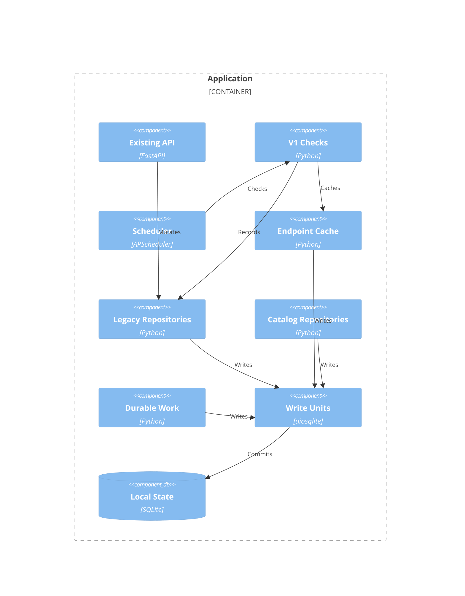

# Implementation Plan: Catalog Persistence and Write Ownership

**Branch**: `00037-catalog-persistence-and-write-ownership` | **Date**: 2026-10-29 | **Spec**: [spec.md](spec.md)

## Summary
**Goal**: Catalog/observation/durable-work persistence with V1 preserved.  
**Approach**: Additive schema; dedicated caller-owned write units across all writers.  
**Key Constraint**: No network-held transactions, guessed identities or new workers.

## Technical Context
**Language/Version**: Python 3.13; TypeScript 5/React 19  
**Primary Dependencies**: FastAPI, aiosqlite, Pydantic, APScheduler, Apprise, Vite  
**Storage**: SQLite/raw SQL; append-only migrations  
**Testing**: pytest/asyncio/httpx; Vitest/RTL; Playwright/axe  
**Target Platform**: Non-root Linux Docker/host  
**Project Type**: web  
**Project Mode**: brownfield  
**Performance Goals**: Max 100-row pages/chunks with 10,000 models; finite budgets  
**Constraints**: WAL, foreign_keys=ON, busy_timeout=5000; local-only storage  
**Scale/Scope**: One trusted-LAN instance; thousands of models, 5–50+ devices  
**Baseline**: [Technical context](../sad.md); ADR-0004, ADR-0015, ADR-0017.

## Instructions Check
| Gate | Pre-design | Post-design evidence |
|------|------------|----------------------|
| Honest failure | PASS | Independent attempts/success; unknown status |
| Politeness | PASS | Central HTTP unchanged; offline migration |
| Ownership | PASS | One SQLite volume; exact variants |
| Trust | PASS | Non-root/unsandboxed boundary unchanged |
| Correctness | PASS | Strict mypy/tsc; real regression gates |
| Reliability | PASS | Dedicated units, rollback and durable fences |
| Layout/output | PASS | backend/src/; explicitly authorized spec/plan size exceptions |
| Governance | PASS | Accepted ADRs govern; no new global decision |

**Authorized exception**: User explicitly permitted E032 plan size above 10 KB on 2026-10-29. Specification size was separately authorized; all behavioral and QC gates remain mandatory.

**Trust boundary**: Trusted-LAN single-user only; untrusted-network exposure unsupported. Modules are user-vetted, unsandboxed, in-process code with full application privileges. Non-root execution remains required. SQL guards and claim tokens protect application integrity/concurrency, not authentication or isolation from privileged extensions; no new account/security service.

## Architecture


## Architecture Decisions
| ID | Decision | Options Considered | Chosen | Rationale |
|----|----------|--------------------|--------|-----------|
| AD-001 | Constructor compatibility | Replace / bound unit + adapter | Existing connection for reads/factory; dedicated standalone writes; bound repos never commit | ADR-0017; no shared-autocommit fallback |
| AD-002 | Memory fixtures | Runtime fallback / migrated fixtures | Temporary file-backed full schema | No anonymous-memory connection sharing or schema hacks |
| AD-003 | Migration boundary | Per-script / pending-upgrade script | BEGIN/scripts/version/COMMIT in one submission after backup | Avoid executescript implicit commit; historical SQL unchanged |
| AD-004 | Existing status | Boolean-only / additive status | Unknown/comparison_unknown and minimal rendering | Honest state, not new catalog UI |

## Data Model Summary
| Entity | Key Fields | Relationships | Notes |
|--------|------------|---------------|-------|
| Catalog/metadata | UUID, source/variant, evidence, aliases/IDs/links | Module; many devices | Rename-safe exact identity |
| Observation/attempt | Provenance/time/generation; separate error | Model/run | Failure cannot freshen |
| Device/module/channel | Link/unknown/revision/status; config generation | Existing IDs/history | Additive only |
| Refresh/item/reevaluation | Scope/budget/deadline/cursor/token | Model or device revision | Dormant; bounded chunks |
| Intent/attempt/evidence | Device/version/channel key, claim/evidence | Stable channels | No sending takeover |
**Detail**: [data-model.md](data-model.md).

## API Surface Summary
N/A — no new public endpoints. Existing responses gain additive comparison status; internal contracts: [data-model.md](data-model.md).

## Testing Strategy
| Tier | Tool | Scope | Mock Boundary | Install |
|------|------|-------|---------------|---------|
| Unit | pytest/asyncio | Canonical identity/version, states | Network only | configured |
| Integration | pytest/httpx | Upgrade, rollback/reopen, writers, V1, claims | Real SQLite; scripted HTTP/dispatch | configured |
| Security | Ruff S/pip-audit/Trivy | SQL, dependencies/image | — | configured; Trivy CI |
| Coverage | pytest-cov | Backend ≥80% | Existing fixtures | configured |
| Frontend | ESLint/tsc/Vitest/Playwright+axe | Regressions; unknown status/a11y | Smoke server | configured |
| Performance | pytest | 10,000-model bounded pages/chunks, WAL readers | No real waits/network | configured |

### Commands
- Backend: `uv run ruff check .`; `uv run mypy --strict .`; `uv run pytest --cov=binocular --cov-report=term-missing --cov-fail-under=80`; `uv run pip-audit` in `backend/`.
- Frontend: `npm run lint`; `npm run typecheck` (existing tsc script); `npm test -- --run --coverage`; `npm run build`; `npx playwright test` in `frontend/`.
- Image: `docker build --load -t binocular:qc-check -f Dockerfile .`; `trivy image --severity HIGH,CRITICAL --ignore-unfixed --exit-code 1 binocular:qc-check`. Missing Docker: QC environment warning, not invented PASS.
- Smoke: existing Playwright webServer; readiness `/api/v1/health`; browser checks existing inventory happy/unknown status, not new catalog UI.

### Acceptance Evidence Matrix
These are required test specifications, not executed test results. Extend existing suites and add the planned `backend/tests/db/` cases; task generation must carry these oracles forward.

| Area / requirement | Fixture or controlled failure | Required observable oracle |
|--------------------|-------------------------------|----------------------------|
| Preservation (TR-001–TR-002, SC-001) | Empty database and populated pre-0011 database with multiple modules/devices, blank/nonblank/Unicode installed text, delivered watermark/history, intervals/pause, guidance, endpoint mappings and leases. Snapshot every legacy column in `modules`, `devices`, `schedules`, `notification_channels`, `activity_log`, `canon_firmware_endpoint_mappings`, `canon_refresh_leases` before upgrade. | After upgrade and reopen, all original fields match byte-for-byte except the specified additive unknown/status backfill; existing IDs, controls, guidance, endpoint timestamps and history survive. New additive fields match defaults/backfill. Catalog/observation/work/intent/attempt tables contain zero invented rows. A rejecting outbound transport observes zero calls. |
| Upgrade failure (TR-001) | Inject backup failure before SQL; separately inject failing statements in the first pending script and a later pending script after an earlier script changed schema/data. Use temporary migration copies, never edit shipped scripts. | Fresh connection after failure matches the complete pre-upgrade schema, data and user_version, including absence of earlier pending changes. Failed backup executes no upgrade SQL. Startup reports failure; successful retry subsequently upgrades once. |
| Restart (TR-003–TR-005, TR-010–TR-011, IP-003) | Close all connections and reopen a file database containing renamed variant identities, aliases/source IDs/links, independent enumeration/verification attempt and success metadata, endpoint cache, claimed partially consumed work, intent attempts/events and accepted history. Advance injected clock across lease, deadline and 24-hour cache boundaries. | UUIDs/metadata/evidence remain exact; failures retain prior successes. Cursors/counters/bounds do not reset. Expired stale tokens cannot mutate; exhausted work cannot resume; interrupted sending becomes uncertain, never reclaimable automatically. Endpoint age <24h is reusable; age =24h or greater is stale, independently of observation verified_at. |
| Determinism (TR-008–TR-012, SC-003–SC-004) | Async barriers/events control writer admission, failure, check completion and commit submission/completion; injected clocks/sleepers control application pacing, deadlines and leases; scripted transports/dispatchers control success/failure/cancellation. | No time.sleep/asyncio.sleep or scheduler luck is an interleaving oracle. Real file-backed SQLite transactions determine commit/rollback truth. The real SQLite busy-timeout test measures the actual lock wait, not a fake sleeper; all other timing is injected. |
| Bounds (TR-008, TR-010) | Hold a writer lock without early release; start a second dedicated writer. Seed 10,000 models; traverse default-50/max-100 local pages and ≤100-row work chunks; exceed limits, consume budgets, cross deadlines and reopen. | PRAGMA busy_timeout=5000; contender fails without writes within 5s + 1s harness tolerance, closes, and cannot commit the owner. Report host timing overruns as failed/blocked evidence, never silently widen tolerance. Each page returns ≤100 models and each chunk processes ≤100 devices with stable ordered cursors; traversal has no omissions/duplicates. Invalid limits are rejected. Exhaustion/deadline prevents new reservations and restart does not replenish immutable limits/counters. Local reads perform zero manufacturer calls; concurrent WAL readers remain usable. |
| Write-unit lifecycle (TR-008–TR-009) | Success, exception, cancellation before/during/after submitted commit, lock timeout and constraint failure. Run instrumented scripted network/dispatch callbacks and SQL tracing across all writer categories below. | Observe BEGIN/commit/rollback and close for each dedicated connection; participating repositories issue no independent commit. Assert WAL, foreign_keys=1 and busy_timeout=5000; invalid foreign-key/cross-module writes fail with no durable residue. At every outbound callback the calling task owns no open write transaction; released resources permit a subsequent writer. Reopen proves the all-or-none actual durable outcome, including honestly identified commits during cancellation. |
| Atomic work (TR-010, SC-004) | Inject failure after observation/device mutation but before enqueue, and after chunk effects but before cursor/counter update. Compete stale run/config/claim/observation generations. Add/edit a device below a model cursor while model work advances; close and reopen. | Rollback removes both mutation and queued work, or both chunk effects and progress; successful unit persists them together. Stale CAS returns conflict and changes no state. Distinct device-revision work survives model cursor advancement/restart and remains claimable for the latest revision; consumption/cursors advance only with the matching bounded effects. No production V1 mutation inserts work/intents or starts new workers. |
| In-flight V1 fence (TR-007, TR-012) | Pause scripted check after captured revision/module/model/link/config; commit installed/unknown edit, confirmation, identity relink or module configuration change, then release the old result. Repeat each fence independently. | Stale result cannot overwrite current status/installed identity, advance watermark or dispatch an alert. Current revision/config result succeeds. Assert unchanged revision for timestamp/watermark-only writes; existing V1 suites still pass. |
| SQL input safety (TR-013, SC-006) | Exercise new and migrated repositories with quote/comment/semicolon/SQL-keyword values in source keys, variant strings, aliases, URLs, cursors and error/evidence fields; request unsupported sort/column/query options. | Allowed data round-trips literally (after documented canonicalization/sanitization) or is rejected; unsupported syntax options execute no SQL. Full schema and unrelated-row snapshot remain unchanged. Test actual parameter binding/allowlist behavior, not security-scanner output alone. |
| Identity/ownership (TR-006, TR-014, SC-007) | Fixture-fed trusted-adapter listing/detail attestation versus arbitrary URL/digest, rejected authority/redirect, mismatched module/key/variant, duplicate aliases, Unicode/case differences, omitted/null dimensions. Attempt raw SQL insert/update violations for devices, items, attempts, intents and reference-invalidating parent changes. | Only a uniquely validated exact tuple resolves; missing required dimensions fail and null is not wildcard. Every invalid raw write fails at SQLite constraint boundary; reopen has no durable residue. Legitimate same-tuple evidence renewal and historical intent retention after a device edit remain valid. No new source parser or V2 interface required in E032. |
| Claim fencing (TR-011, SC-008) | File-backed real transactions, barriers and injected clocks race acquisition/authorization; expire tokens and vary each device/observation/module/channel fence independently. Interrupt sending, append late acceptance, and retry with/without acknowledgement and independently proven owner stoppage. | One authorization per attempt; stale transitions return conflict without intent/watermark changes. Stale evidence attaches only to original attempt. Interrupted sending is uncertain; accepted/late-accepted evidence bars automatic acquisition. Neither lease expiry nor acknowledgement alone enables retry. Explicit retry creates a new fenced attempt only after stoppage evidence. No network dispatch/worker activation is required for these persistence tests. |
| Secret exclusion (TR-015, SC-006) | Seed provider errors, URLs, headers and receipts with distinct passwords, API/bearer/refresh tokens, cookies, webhook secrets and signed-query values, including overlong errors and sanitizer failure. Capture diagnostic output and query every persisted evidence/error/URL/receipt field. | Zero seeded credential values in storage or logs; no raw body/config/exception fallback. URL userinfo/query/fragment values absent, safe error code/status/operation retained, unsafe receipt redacted. Sanitization precedes truncation and immutable inserts. |

### Existing-Writer Regression and Concurrency Coverage
Every row must exercise a real successful write and an injected partial-failure interleaving against an independent successful writer, then reopen to prove no cross-owner commit. Reuse the Ownership Acceptance Cases in `data-model.md`; cover cancellation/resource cleanup through the shared write-unit matrix above. Paths below are existing regression suites under `backend/tests/`, not claims that new assertions already exist.

| Writer category | Suites to extend / retain |
|-----------------|--------------------------|
| Device CRUD, confirmation, installed state and check/watermark | `devices/test_repository.py`, `devices/test_service.py`, `devices/test_routes.py`, `services/test_checks.py` |
| Module lifecycle/configuration, pause and scheduling | `extensions/test_repository.py`, `routes/test_modules.py`, `services/test_scheduler.py`, `routes/test_schedules.py` |
| Module/settings seeding | `test_seeder.py`, `services/test_settings_seeder.py` |
| Activity writes | `test_activity_repository.py`, `test_activity_logging_integration.py` |
| Notification configuration, dispatch bookkeeping and history | `test_notifications.py`, `services/test_checks.py` |
| Canon cache mappings, invalidation and leases | `test_canon_endpoint_cache.py`; retain transport/status/parsing/model-identity invalidation, fallback and single-flight assertions |
| Backup/maintenance and migration | `services/test_backup.py`, `routes/test_backups.py`, `test_migrations.py`; separate connection ownership and fatal backup gate |

### Validation Gate Evidence
- Execute every command above, retaining command, working directory, exit status and actual report. Backend and frontend coverage each require ≥80% (frontend configured lines/statements/functions/branches); strict typecheck/lint, full regression and official-module fixture suites, dependency audit, bounded-work performance cases, Docker build and applicable Trivy image scan remain required.
- Extend `frontend/e2e/source-accessibility.spec.ts` and `frontend/e2e/source-guidance.spec.ts` for existing inventory unknown/comparison_unknown status, keyboard/screen-reader semantics and axe checks; no new catalog combobox or Modules UI is introduced. Retain the existing end-to-end happy path and assert zero source requests from local form interaction.
- Missing mandatory tools or unavailable services are recorded as NOT RUN/BLOCKED with the attempted command/error, never PASS or an implicit waiver. Re-run in a capable environment/CI and attach actual evidence before claiming the applicable gate passed. A local Docker warning does not waive image build before merge or vulnerability scanning before release; no release-ready claim or QC pass marker may substitute for missing mandatory validation.

## Error Handling Strategy
| Error Category | Pattern | Response | Retry |
|----------------|---------|----------|-------|
| Migration | Backup gate; atomic rollback | Visible startup failure | Fix root cause |
| Identity/revision | Exact validation/CAS | Unresolved/conflict, no guessing | Corrected mutation |
| Busy/cancellation | Bounded wait; rollback/drain commit | Honest outcome; always close | Caller-owned |
| Work/claim | Token/config/revision fencing | Typed conflict | Eligible work only |
| Interrupted send | Evidence + uncertain | No automatic replay | Acknowledged explicit retry |

## Integration Points
| Spec Reference | System/Service | Technical Approach | Contract |
|----------------|----------------|--------------------|----------|
| IP-001 | Migrations/backup | Atomic upgrade; dedicated units/backup connection | ADR-0004 |
| IP-002 | Devices/notifications | Preserve IDs/history; revision fences | Existing API + status |
| IP-003 | Canon cache | Unit-owned writes/leases; coalescing unchanged | Cache fixtures |
| IP-004 | All writers | No shared commits; short units | AD-001 |
| IP-005 | Future epics | Typed dormant repositories | Data model |

## Risk Mitigation
| Risk (from spec) | Likelihood | Impact | Mitigation | Owner |
|------------------|------------|--------|------------|-------|
| Hidden write participant | High | High | Commit-path audit; interleaving tests | DB/runtime |
| Unsafe identity backfill | Medium | High | No fabricated rows; exact evidence/SQL guards | Catalog |
| Interrupted transaction/delivery | Medium | High | Drain commit; immutable evidence/uncertain fence | UoW/delivery |

## Requirement Coverage Map
Paths below are relative to `backend/src/binocular/` unless explicitly prefixed.

| Req ID | Component(s) | File Path(s) | Notes |
|--------|--------------|--------------|-------|
| TR-001 | Migrations | db/migrations.py; backend/tests/test_migrations.py | Atomic failure/reopen |
| TR-002 | Schema | db/migrations/0011_catalog_foundation.sql; backend/tests/db/test_catalog_migration.py | Preserve legacy state |
| TR-003 | Identity | db/catalog_types.py; db/catalog_repository.py | Variant/UUID/rename |
| TR-004 | Enumeration | db/catalog_repository.py; db/work_repository.py | Complete-only missing |
| TR-005 | Observations | db/observation_repository.py | Independent attempts/success |
| TR-006 | Resolver | db/catalog_repository.py; devices/repository.py | Evidence/SQL guards |
| TR-007 | Device/check | devices/; services/checks.py; frontend/src/ | Unknown/revision/status |
| TR-008 | UoW/base | db/unit_of_work.py; db/repository.py | Owner/commit boundary |
| TR-009 | Writers | services/; db/; official_modules/canon_endpoint_cache.py | Coherent ownership |
| TR-010 | Work | db/work_repository.py; db/observation_repository.py | Atomic bounded work |
| TR-011 | Delivery | db/delivery_repository.py; db/catalog_types.py | Unique/fenced/uncertain |
| TR-012 | Validation | backend/tests/db/; backend/tests/services/; frontend/e2e/ | Dormant/V1 regressions |
| TR-013 | SQL input boundary | db/repository.py; db/*_repository.py; backend/tests/db/test_catalog_security.py | Bound values/fixed syntax allowlists across migrated writers |
| TR-014 | Evidence/ownership | db/catalog_types.py; db/catalog_repository.py; db/migrations/0011_catalog_foundation.sql; backend/tests/db/test_catalog_security.py | Captured-response authority; insert/update and parent guards |
| TR-015 | Safe evidence/diagnostics | db/catalog_types.py; db/observation_repository.py; db/work_repository.py; db/delivery_repository.py; backend/tests/db/test_catalog_security.py | Sanitize before persistence/logging; safe fallback |

## Project Structure
### Source Code
```text
backend/src/binocular/
  db/ +unit_of_work.py +catalog_types.py +catalog_repository.py
      +observation_repository.py +work_repository.py +delivery_repository.py
      ~repository.py ~connection.py ~migrations.py ~activity_repository.py
      ~notifications_repository.py +migrations/0011_catalog_foundation.sql
  devices/ ~repository.py ~models.py ~service.py
  services/ ~checks.py ~scheduler.py ~seeder.py ~settings_seeder.py ~backup.py
  extensions/ ~repository.py
  official_modules/ ~canon_endpoint_cache.py
  ~app.py ~deps.py
backend/tests/ ~existing fixtures/tests +db/test_catalog_*.py +db/test_write_ownership.py
frontend/src/ ~existing device/check type and inventory status components
frontend/ ~package.json ~existing tests/e2e status assertions
```
**Patterns to reuse**: Raw SQL, migration/backup gate, scripted HTTP/async tests.  
**Tests to extend**: Migrations, devices, checks/scheduler/notifier, Canon cache, inventory/axe smoke.  
**Naming conventions**: snake_case Python; existing feature-based React.

## Implementation Hints
- **[HINT-001]** Order: UoW/base before all writers; no shared-commit fallback. Replace memory fixtures with migrated files.
- **[HINT-002]** Gotcha: BEGIN and version/COMMIT go inside executescript, never before it.
- **[HINT-003]** Constraint: Shared lifespan reads only; no scraper/module/dispatch inside transactions.
- **[HINT-004]** Compatibility: Unknown/opaque is not current; fence stale checks; V1 never enqueues dormant work.
- **[HINT-005]** Performance: Max100 chunks, monotone cursors, immutable finite budgets; no new workers or sending takeover.
