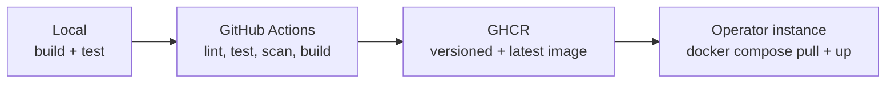
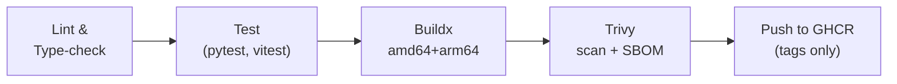
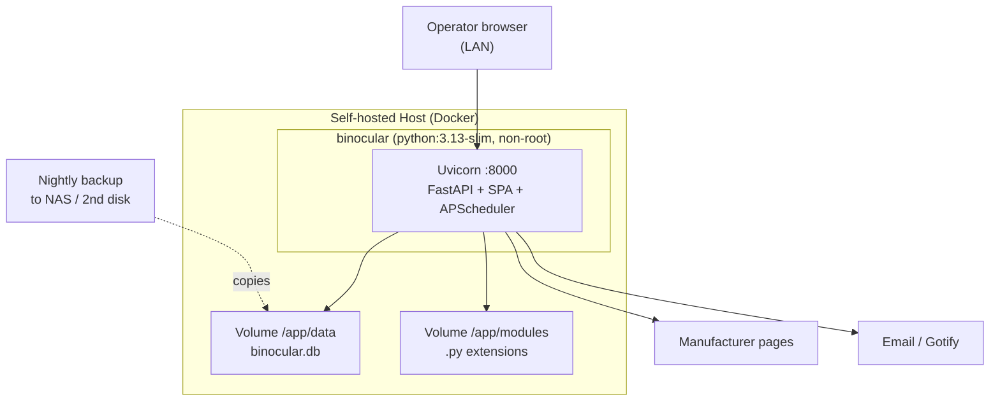
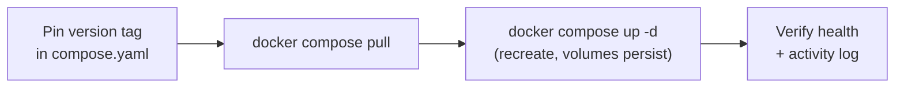

# Deployment & Operations Document: Binocular

> Date: 2026-10-29 | Status: Draft

## Deployment Summary and Context

Binocular ships as a **single, self-contained Docker image** that an operator runs on a private, trusted LAN. The deployment goal is set-and-forget homelab operation: one container, one port, one data volume, non-root, zero external dependencies (no database server, broker, or cloud service). This document covers how that image is built, distributed, configured, backed up, and operated. It complements — and does not repeat — the architecture in [specs/sad.md](sad.md).

Operational ambition is intentionally **homelab-grade and minimal**: there is no environment ladder, no SLO/error-budget/on-call machinery, no IaC, and no external telemetry.

The catalog-first release keeps the same image, port, SQLite volume, modules volume, and trusted-LAN boundary. “Global” is instance-local only: no hosted catalog, broker, account, synchronization service, or additional infrastructure. Active unpaused catalog modules now discover/verify models even when inventory is empty; source load is governed by module-wide controls and bounded background work, not owned-device count. These are release requirements for future implementation, not a claim that catalog migration has shipped.

## Environment Strategy

Binocular has two effective environments: a developer workstation and the operator's production instance. They run the same image; there is no shared staging tier.

| Environment | Purpose | Promotion Gate | Data Strategy | Parity with Prod |
|-------------|---------|----------------|---------------|------------------|
| Local (dev) | Build, test, and validate modules locally | CI green on PR | Seed/fixtures + golden module tests | High — identical image build |
| Production (operator) | The operator's live homelab instance | Operator pulls a published SemVer tag | Real SQLite data on a persistent volume | Baseline |

### Environment Flow

### Progressive Rollout

- **Feature flags**: None. Behavior is controlled by environment variables and the operator's chosen image tag.
- **Rollout strategy**: Operator-driven. Each release is a published image tag; the operator updates when they choose.
- **Rollback trigger**: Operator pins the previous known-good SemVer tag and recreates the container (see [Rollback](#rollback)).
- **Catalog transition**: Stage the compatible schema/write-ownership foundation, V2/V1 negotiation, background refresh, official-module migration, shared comparison/delivery, and local onboarding before declaring the catalog-first release ready. Intermediate images must keep V1 monitoring functional and identify unavailable catalog capabilities honestly; no schema migration may invoke manufacturers or require network access.

## Deployment Targets and Packaging

- **Deployment model**: Single OCI container image (multi-stage build — Node stage compiles the Vite SPA, final `python:3.13-slim` stage serves it via FastAPI `StaticFiles`).
- **Build artifact**: One Docker image, multi-arch `linux/amd64` + `linux/arm64` (covers x86 homelab hosts and ARM SBCs such as Raspberry Pi).
- **Container registry**: GitHub Container Registry (GHCR), public — `ghcr.io/<owner>/binocular`.
- **Image tagging**: Driven by SemVer git tags via `docker/metadata-action` — `{{version}}`, `{{major}}.{{minor}}`, and `latest`. The `{{major}}` tag is enabled only for `>= v1.0.0`. Base image pinned by digest for reproducibility.
- **Vulnerability scanning**: Trivy (`aquasecurity/trivy-action`) in CI against the built image; fail on HIGH/CRITICAL with available fixes. Weekly scheduled re-scan of the published image since it is long-lived.
- **SBOM / provenance**: Emitted by buildx (`sbom: true`, `provenance: true` on `build-push-action`) and attached as OCI attestations.

## CI/CD Pipeline Design

### Pipeline Stages

- **Pipeline tooling**: GitHub Actions.
- **Quality gates (PRs and pushes)**: Ruff + mypy `--strict` (backend), Biome/ESLint + `tsc` (frontend); pytest/pytest-asyncio, Vitest/React Testing Library, Playwright smoke, 80% coverage, golden fixtures, image scanning, and deterministic injected-time HTTP tests for shared pacing, retries, bounded execution, timeout, and cancellation. No mandatory validation relies on live manufacturers or real sleeps.
- **Catalog gates**: Test all official modules' explicit V2 capability, enumeration/compatible identity/aliases, inline versus per-model firmware, shared index request counts, continuation/completeness, and explicit no-firmware versus structural errors. Verify V1 custom-module acceptance/fallback, unsupported protocol rejection, version-aligned validator/harness/templates/AI Module Kit, safe module update/downgrade/delete, and preservation of IDs/controls. Exercise every active zero-inventory module, pause/frequency/manual refresh, overlap coalescing, bounded fair batches, partial failure without data loss/freshness inflation, cursor/lease restart recovery, and independent per-model verification.
- **Local UI gates**: Against a 10,000-model fixture, prove bounded default-50/max-100 local query/result/render sizes; alias search, compatibility selection, keyboard/status semantics, all loading/empty/no-match/stale/failed/legacy states, explicit refresh/retry, and zero manufacturer calls from either Add Device or Modules browsing/typing/selection. Direct inventory creation must preselect the shared form, allow multiple physical copies, never fill installed from latest, and handle unknown explicitly.
- **Consistency/delivery gates**: Test write-ownership isolation across scheduler/cache/device/notifier writers, atomic observation/mutation plus reevaluation, bounded lossless fan-out, canonical per-device/version/channel uniqueness, exclusive claims/fencing, add/edit/confirmation races, preserved delivery history, partial channel failure/retry, and restart/restore uncertainty without duplicate successful-channel sends. Both HTML Email/SMTP and Gotify remain covered; no end-to-end exactly-once claim is permitted.
- **Canon regression gates**: Preserve separate EOS R and RF/RF-S fixtures, exact/near-name/classification checks, OS-package deduplication, official release links, auto-seeding, and visible no-firmware/structure failures. Endpoint mappings expire at exactly 24 hours and invalidate on transport/status/parsing/identity failure with one full-discovery recovery. Warm live model verification issues one paced firmware request and shares same-model work; 0-30 seconds without contention and 90-120 second cold discovery are model-level expectations, not a deadline for a whole catalog. Persisted observations and DB-only UI reads are tested separately from live verification.
- **Build stack**: `docker/setup-qemu-action` → `docker/setup-buildx-action` → `docker/login-action` (GHCR via `GITHUB_TOKEN`, `permissions: packages: write`) → `docker/metadata-action` → `docker/build-push-action` with `platforms: linux/amd64,linux/arm64`.
- **Publish condition**: Images are pushed only on SemVer tag refs; PR builds build-but-do-not-push. Layer caching via `type=gha` (`mode=max`).
- **Secrets in pipeline**: Only the built-in `GITHUB_TOKEN` for GHCR; no application secrets are baked into the image or passed as build args.

## Infrastructure and Hosting

- **Hosting**: Self-hosted by the operator (homelab host, NAS, mini-PC, or SBC). No cloud provider.
- **Compute model**: A single Docker container managed by Docker / Docker Compose. No orchestrator assumed or required.
- **Networking**: One exposed port (`8000`) on the trusted LAN. TLS, if desired, is provided by the operator's own reverse proxy — out of scope for the image.
- **Storage infrastructure**: Two persistent volumes — `/app/data` (SQLite `binocular.db`) and `/app/modules` (user extension `.py` files). Operator-managed; backed up by file/volume copy.
- **Container hardening**: Non-root user configurable via `PUID`/`PGID` environment variables (default `PUID=1000 PGID=1000`), applied at entrypoint via user/group creation and `su-exec`; `no-new-privileges:true`, `cap_drop: [ALL]`; optional `read_only` rootfs with a `tmpfs` for `/tmp`. See {SAD:ADR-0008}, {SAD:ADR-0001}.
- **Configuration Environment Variables**: The following variables configure the application settings, basic authentication, and notification channels:
  - `BINOCULAR_HOST`: Server binding address (default: `0.0.0.0`).
  - `BINOCULAR_PORT`: Server binding port (default: `8000`).
  - `BINOCULAR_AUTH_ENABLED` / `BINOCULAR_BASIC_AUTH_ENABLED`: Enable basic authentication (default: `false`).
  - `PUID` / `PGID`: Container user and group ID (default: `1000`).
  - `GOTIFY_URL` / `BINOCULAR_GOTIFY_URL`: Gotify server URL.
  - `GOTIFY_TOKEN` / `BINOCULAR_GOTIFY_TOKEN`: Gotify application token.
  - `SMTP_HOST` / `BINOCULAR_SMTP_HOST`: SMTP server hostname.
  - `SMTP_PORT` / `BINOCULAR_SMTP_PORT`: SMTP server port (default: `587`).
  - `SMTP_USE_TLS` / `BINOCULAR_SMTP_USE_TLS`: Enable SMTP TLS (default: `true`).
  - `SMTP_USERNAME` / `BINOCULAR_SMTP_USERNAME`: SMTP login username.
  - `SMTP_PASSWORD` / `BINOCULAR_SMTP_PASSWORD`: SMTP login password.
  - `SMTP_FROM` / `BINOCULAR_SMTP_FROM`: SMTP sender email address.
  - `SMTP_TO` / `BINOCULAR_SMTP_TO`: SMTP recipient email address.

### Infrastructure Diagram

## Observability and Monitoring

No external telemetry, metrics backend, or APM — by design.

### Logging
- **Approach**: Structured logs via `structlog` to stdout/stderr, correlated by module/model/refresh-run/device/delivery/attempt IDs. Include enumeration versus firmware phase, work generation, progress/completeness, last attempt/last success, claim outcome, and retry/uncertain state; never log notification credentials.
- **Aggregation**: `docker logs` / `docker compose logs -f`. The operator's Docker logging driver handles rotation.
- **In-app activity log**: A bounded, size-limited recent-events log persisted in SQLite and viewable in the UI.

### Metrics
- **Application signals**: Local UI only — module enumeration attempt/last-success and next-due/pause/capability, discovered/verified/pending/failed model counts, per-model verified age/source status, partial/failed run progress, bounded budget/cancellation failures, comparison backlog, delivery backlog/failure/uncertain counts, and oldest pending work age. Firmware health is not inferred from successful enumeration or notification delivery.
- **Infrastructure signals**: Container health and data-volume disk usage observed via the operator's own Docker tooling.

### Health Checking
- **Container HEALTHCHECK**: `--interval=30s --timeout=5s --start-period=20s --retries=3` against a cheap `/healthz` endpoint. Drives `docker ps` health status and `restart` policy.

### Alerting
- **Self-notification**: Binocular can dispatch operational failures through its own Apprise channels.
- **Official module health**: Aggregate enumeration/verification failures and stale progress even with zero inventory; authoritative per-model no-firmware is not scraper breakage (CAP-014).
- **What the operator watches**: Container health, overdue/failed/partial refreshes, stale model observations, stuck resumable work, notification failed/uncertain outcomes, bounded backlog, `/app/data` disk usage, and restart loops. A healthy process does not prove fresh catalog data or delivered alerts.

## Reliability Engineering

- **Availability target**: Best-effort homelab availability; `restart: unless-stopped` plus the HEALTHCHECK recover from crashes.
- **Outbound-work containment**: A check's finite end-to-end budget covers robots lookup, shared per-origin queueing/pacing, retry backoff, redirects, and HTTP attempts. Timeout or cancellation must terminate pending waits and retries and prevent later background requests. Source-specific budget accommodation is automatic and capped; origins without a longer valid crawl delay retain existing budgets.
- **Catalog freshness**: Retain last-known observations/provenance across failure; failed/unverified models never advance successful timestamps, while successful units in a partial module run keep their own verification. Observation age is fresh only below the module interval (default daily); stale/failed verification remains browseable but cannot establish new current/alert claims. Pause is scheduling status, not automatic invalidation: explicit successful manual refresh while paused uses normal comparison/alert semantics. See {SAD:ADR-0015}.
- **Canon discovery metadata**: Endpoint mappings, separate from persisted firmware observations, remain usable only below 24 hours. Expired mappings are bypassed; transport/status/parsing/model-identity failure invalidates them and permits one full paced discovery fallback. A new successful model verification always derives from a matching live response through centralized policy; failed recovery stays visible. Preserve the shared 30-second Canon origin timeline and same-model coalescing.
- **Restart recovery**: Rebuild module jobs from stored controls/capability, including zero-inventory sources; coalesce missed windows, recover valid refresh/fan-out cursors, fence old generations, and do not silently reset exhausted budgets. Interrupted notification sends become uncertain, not automatically replayable. Definite failures retry per channel through the same durable intent; successful channels are not resent. See {SAD:ADR-0017}.
- **RPO** (Recovery Point Objective): **≤ 24h** — a nightly backup of `/app/data` to a second host/disk/NAS.
- **RTO** (Recovery Time Objective): **≤ 1h** — pull the image tag, restore the data file, `docker compose up -d`.

### Backup and Restore
- **Backup (live-safe)**: Use SQLite `VACUUM INTO 'backup.db'` or the Online Backup API (`Connection.backup()`) for a consistent single-file snapshot. A scheduled (APScheduler) nightly job produces the snapshot; the operator copies it offsite.
- **Raw-copy caveat**: If copying the volume directly, copy `binocular.db` together with its `-wal`/`-shm` files, or run `PRAGMA wal_checkpoint(TRUNCATE)` first.
- **Restore**: Stop the container → replace `/app/data/binocular.db` (and remove stale `-wal`/`-shm`) → start. Boot path runs `PRAGMA integrity_check;`.
- **Disaster recovery**: One offsite copy is sufficient at homelab scale.
- **Catalog-aware verification**: Snapshots must include model identity/aliases/variants/observations, inventory associations/versions/history, module controls, refresh cursors/leases, reevaluation work, notification intents, and channel outcomes. After restore, verify identities/link counts, pause/frequency, stale/failure timestamps, and notification history before permitting dispatch. Restored pending/failed/sending work may have been delivered after the snapshot: reconcile or classify affected restored deliveries uncertain rather than blindly replaying. Resume safe catalog/local comparison work separately; never rebuild inventory from discovery.

### Migration Safety
- Schema migrations run at startup inside a transaction, gated by `schema_version` / `PRAGMA user_version`, forward-only and idempotent. An automatic **pre-migration backup** is taken so a failed migration or a rollback to a previous image tag is recoverable. See {SAD:ADR-0004}.
- Catalog migration is additive and offline: retain device/module IDs, installed values including unknown, saved frequency/pause, and notification history; nullable model links identify V1/unresolved rows. Only later verified exact unambiguous compatibility matches may backfill links, never display-name guessing or fabricated inventory-derived catalog rows. Preserve endpoint-cache state and keep its TTL distinct from observations.
- Transactional catalog/reevaluation/outbox behavior is gated on coherent caller-owned write connections/units of work across all writers, not a competing lock over the existing shared connection. Test empty and populated upgrades, failed migration recovery, restart, and rollback restoration before release. See {SAD:ADR-0017}.

### Capacity and Refresh Control

Catalog size, not owned-device count, determines source traffic and storage. Reuse shared indexes within a refresh; sources requiring per-model details keep those requests explicit. Bound pages, concurrent work, per-model deadlines, per-run budgets, fan-out transactions, and retained attempt/log history; preserve required referenced identities and deduplication state. Test at least 10,000 local models. Paginate local reads and rendering (default 50/max 100); do not hold DB write transactions during network I/O. Fair resumable batches must allow slow sources and other modules to progress, ending exhausted runs visibly partial/failed rather than looping indefinitely. Frequency/pause reduces automatic load without deleting models or changing physical inventory; no operator setting bypasses robots/pacing.

### Catalog and Delivery Incident Handling

For stale/failed refresh, inspect module capability, last enumeration versus firmware success, source guidance, progress, and structured errors. Keep last-known data visible; pause automatic work if needed, use explicit paced refresh/retry, and update the module only after reviewing changed source behavior. Do not delete models or re-add inventory to fix a source outage. Missing models require a complete authoritative scan before marking unavailable; failed/partial scans are not deletions.

For notification failure, test channel configuration, then retry the failed channel through its existing intent; never reset all notification history. For uncertain acceptance or restored delivery history, inspect attempt evidence and explicitly approve duplicate-risk retry if needed. No automatic resend on timeout/restart/restore may pretend SMTP/Gotify has universal exactly-once semantics. A message accepted before an installed-version edit cannot be recalled; expose that race rather than hiding it.

### Production Readiness
- Non-root image builds and HEALTHCHECK pass.
- A restore from backup has been verified at least once.
- SMTP and/or Gotify notification channels validated end-to-end.
- Deterministic HTTP-client validation confirms delay selection, cross-origin independence, same-origin concurrency pacing, every retry, finite source-aware budgets, and no request issuance after timeout/cancellation.
- All catalog, local UI accessibility/performance, migration/write-ownership, shared-loop/delivery, and Canon regression gates above pass without live-source dependence. V1 monitoring, explicit unresolved inventory, saved controls/history, and both onboarding entry points survive upgrade/restart; last-known data is never advertised as newly verified.
- Release documentation states that Canon coverage is based on Canon Asia English EOS R and RF/RF-S catalogues, excludes adapters/extenders/unrelated mounts, explicitly excludes Cinema EOS/EOS R5 C pending a verified flow, and does not claim a positive RF-S firmware release.
- Operator has pinned a specific SemVer tag.
- Catalog refresh/partial progress and notification failure/uncertain-retry/restore guidance ship with version-aligned authoring docs, validator/harness, templates, and AI Module Kit; all official modules declare verified catalog capability. Release readiness requires the corresponding implementation quality gates, not this document amendment alone.

## Security and Compliance in Operations

### Supply Chain Security
- **SBOM**: buildx-generated, attached as an OCI attestation.
- **Dependency scanning**: Trivy in CI; backend deps hash-pinned (`uv.lock`), frontend via `package-lock.json` + `npm ci`.
- **Artifact provenance**: buildx provenance attestation on published images.

### Runtime Security
- **Trust boundary**: Extension modules in `/app/modules` execute **unsandboxed, in-process, with full app privileges**. Accepted under the trusted-LAN single-user threat model. Operators must **not** expose port 8000 to untrusted networks. Catalog capability/runtime validation does not create a sandbox. See {SAD:ADR-0016}, {SAD:ADR-0008}.
- **Container**: non-root user (PUID/PGID configurable), `no-new-privileges`, `cap_drop: [ALL]`, optional read-only rootfs.

### Secrets Management
- **Secrets store**: Environment variables, with the `_FILE` convention for Docker/Compose secrets. Sensitive variables (`GOTIFY_TOKEN`, `SMTP_PASSWORD`, and `BASIC_AUTH_PASSWORD`) support both prefixed (e.g. `BINOCULAR_GOTIFY_TOKEN_FILE`) and non-prefixed (e.g. `GOTIFY_TOKEN_FILE`) file-based settings.
- **Rotation**: Operator-managed; update the secret/env and recreate the container.
- **Access pattern**: Injected at runtime; never baked into the image.

### Compliance
- **Frameworks**: None applicable (single-user, self-hosted, no personal-data processing beyond the operator's own inventory).

## Operational Ownership and Processes

- **Ownership model**: The self-hosting operator is the sole owner and operator. Project maintainers own the image, CI, and release tags.
- **Change management**: PR-based with CI quality gates; releases cut by tagging a SemVer version.
- **Documentation expectations**: Preserve compose/env/run/upgrade guidance and regional coverage notes. Explain instance-local catalogs versus owned devices, module-wide frequency/pause and zero-inventory egress, background refresh/partial/failure recovery, local-only onboarding/browsing, unknown installed versions, V1 fallback/migration, and safe backup/rollback/delivery retry. Version-align README/authoring docs, validator/harness/templates/examples, AI Module Kit, and official modules. Canon notes retain source catalogues/families, official release semantics, 30-second pacing, separate endpoint TTL and observation freshness, model-level warm/cold expectations, fallback behavior, Cinema EOS/EOS R5 C exclusion, and no claim of a positive RF-S release.

### Update Workflow

### Rollback

- Pin the previous known-good SemVer tag in `compose.yaml`, then `docker compose pull && docker compose up -d`.
- Because migrations are forward-only, pair any rollback that crosses a schema change with the **pre-migration backup** taken at upgrade time.
- Stop the newer image before restore. Restore the matching schema snapshot and compatible custom-module files; a V1-only image must not load V2-only files as if supported. Inventory/controls created after that snapshot require deliberate reconciliation. Reconcile potentially already-delivered notifications before resuming dispatch to avoid replaying old intents; never run the older image against the upgraded catalog schema on assumption alone.

## Cost Considerations

- **Estimated cost**: Effectively $0 beyond the operator's existing hardware and electricity. GHCR is free for public images; GitHub Actions covers public-repo CI.

## Deployment Decisions

### DDR-001: GitHub Actions → public multi-arch GHCR image driven by SemVer tags

- **Status**: Accepted
- **Context**: An OSS self-hosted app needs a free, trusted distribution channel covering both x86 and ARM homelab hosts, with reproducible, pinnable releases.
- **Decision**: Build with `docker buildx` (QEMU) in GitHub Actions for `linux/amd64` + `linux/arm64`, publish to public GHCR, and tag from SemVer git tags.
- **Rationale**: Zero cost for public repos, native fit with GitHub, arm64 reach for SBC users, version pinning for operators.

### DDR-002: Minimal homelab-grade operations posture

- **Status**: Accepted
- **Context**: The system is a single-user, trusted-LAN, no-telemetry app. Enterprise ops machinery would be disproportionate.
- **Decision**: Operate at homelab scale — Docker/Compose only, stdout logs + in-app activity log, a shallow HEALTHCHECK, Apprise self-notification, and file-copy backups.

### DDR-003: SQLite backup via Online Backup API / `VACUUM INTO`, not raw copy

- **Status**: Accepted
- **Context**: The data store is a WAL-mode SQLite file; naive copying under load risks an inconsistent snapshot.
- **Decision**: Take backups with `VACUUM INTO` or the Online Backup API on a nightly schedule, plus an automatic pre-migration snapshot.

### DDR-004: Linuxserver-style PUID/PGID entrypoint for configurable container user

- **Status**: Accepted
- **Context**: Operators mount persistent volumes owned by arbitrary host UIDs. A fixed non-root UID creates friction.
- **Decision**: Adopt the linuxserver.io pattern: an entrypoint script reads `PUID` and `PGID` environment variables (defaulting to `1000:1000`), creates a matching user/group, `chown`s the volumes, then drops privileges via `su-exec`.
- **Rationale**: Single established convention familiar to homelab operators; eliminates the most common permission support issue; backward compatible.

### DDR-005: Operate catalog refresh and delivery locally with bounded durable work

- **Status**: Accepted
- **Context**: Catalog-capable modules now refresh unowned as well as owned models; full-catalog detail work and shared-result fan-out can exceed old per-device assumptions, while concurrent notification delivery needs restart-safe outcomes.
- **Decision**: Keep the existing container/SQLite/APScheduler/Apprise topology. Require bounded fair refresh and fan-out, module-wide controls, visible freshness/partial/failed state, local paged UI reads, safe offline migration/restore, and durable per-channel delivery retry/uncertainty handling under ADR-0015/0016/0017.
- **Rationale**: Shares discovery inside the operator's instance without external infrastructure, unbounded source load, or alert replay storms.
- **Tradeoffs**: More models increase paced background duration and local work state; retained observations can lag sources. Operators need visible progress and deliberate handling of ambiguous/restored deliveries, not cloud coordination or exactly-once promises.

## Risks, Assumptions, Constraints, and Open Questions

### Risks

- Operator exposes port 8000 beyond the trusted LAN — mitigated only by documentation and optional basic auth.
- Operator never configures or tests backups — mitigated by shipping a built-in scheduled backup job and verified-restore documentation.
- Multi-arch QEMU build flakiness — mitigated by caching and optional native arm64 runners.
- Long source-declared crawl delays can exceed a multi-request check's finite cap — mitigated by automatic bounded budget accommodation and visible failure rather than unbounded background work or policy violation.
- Canon Asia can change catalogue membership, form actions, regional publication timing, or robots policy — mitigated by captured-fixture release gates, current-policy review, and explicit regional limitations rather than fallback-region rotation.
- Larger catalogs and long per-origin delays can leave refresh work overdue — mitigate with shared index reuse, finite fair batches, progress visibility, and module-wide frequency/pause rather than inventory-based refresh suppression.
- Restore or ambiguous channel acceptance can otherwise replay alerts — mitigate with preserved delivery evidence, uncertain states, and explicit duplicate-risk retry/reconciliation before dispatch resumes.

### Assumptions

- The host runs Docker (or a compatible runtime) with persistent volumes.
- The operator can reach a second disk/host/NAS for offsite backup copies.
- The operator controls their own TLS/reverse proxy if exposing beyond LAN.

### Constraints

- Single container, single port, single data volume, non-root, zero-config startup.
- No external database, broker, telemetry, or cloud dependency.
- Responsible-scraping behavior requires no operator configuration; source-specific timing remains centralized, bounded, and cancellation-safe, with existing budgets preserved for unaffected origins.

### Open Questions

- None. All prototype-era operational open questions have been resolved.
