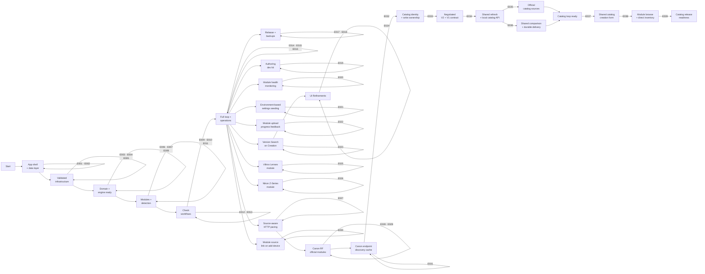

# Project Implementation Plan

**Product**: Binocular — self-hosted firmware-update watcher for offline devices
**Created**: 2026-06-10 | **Status**: Draft
**Total Epics**: 39 (P1: 25 · P2: 14) | **Waves**: 26

Informed by the prototype retrospective at `specs/prototype-retrospective.md`. Key consolidation decisions: device type is module-derived from the start (no standalone DeviceType entity); notification deduplication and HTML email are part of the initial notification epic; shadcn/ui is the component library from day one; PUID/PGID entrypoint is part of the foundation container epic; collapsible navigation is part of the SPA shell.

Amended 2026-10-29 for instance-local catalog-first discovery under project instructions v2.0.0. E001–E031 and their detail files remain completed historical scope; E032–E039 deliver the changed architecture without retroactively rewriting those increments. The new P1 sequence includes official-module migration and release validation because catalog-backed onboarding requires working sources and safe delivery. “Global” is local to this SQLite instance, not cloud infrastructure.

## Epic Checklist

### Wave 1 — Foundation

> No dependencies. Establishes the runnable application shell, container with PUID/PGID entrypoint, and the data layer so all later work has something concrete to validate.

- [X] E001 [P1] [TECHNICAL] {SAD:ADR-0001}{SAD:ADR-0002}{SAD:ADR-0008}{DOD:DDR-004} Application Skeleton & Container — layered FastAPI app, config, /healthz, non-root image with PUID/PGID entrypoint [→ Details](plan/E001.md)
- [X] E002 [P1] [TECHNICAL] [P] {SAD:ADR-0004}{DOD:DDR-003} Data Layer & Migrations — aiosqlite, raw SQL, numbered migrations, pre-migration backup [→ Details](plan/E002.md)

### Wave 2 — Validation & Frontend Shell

> Depends on E001/E002. CI pipeline validates every increment; SPA shell provides the UI framework with shadcn/ui from day one.

- [X] E003 [P1] [OPERATIONAL] [P] {DOD:DDR-001}{DOD:DDR-002} Continuous Integration Pipeline — lint, type-check, test, image build on every change [→ Details](plan/E003.md)
- [X] E004 [P1] [TECHNICAL] [P] {SAD:ADR-0003} Frontend SPA Shell — React/Vite/shadcn/ui app with collapsible nav, dark mode, version display [→ Details](plan/E004.md)
- [X] E005 [P1] [TECHNICAL] [P] {SAD:ADR-0006} Responsible Scraping Client — central polite httpx client with robots.txt, rate limiting, backoff [→ Details](plan/E005.md)

### Wave 3 — Domain & Module Engine

> Build the inventory model (device linked to module from the start), the module engine, and operability. Distinct areas → parallel.

- [X] E006 [P1] [PRODUCT] [P] {PRD:CAP-001}{SAD:ADR-0009} Device Inventory Management — module-linked inventory, stored versions, update confirmation [→ Details](plan/E006.md)
- [X] E007 [P1] [TECHNICAL] [P] {PRD:CAP-002}{SAD:ADR-0005} Module Engine & Contract — loader, error boundary, two-phase validation [→ Details](plan/E007.md)
- [X] E008 [P1] [PRODUCT] [P] {PRD:CAP-009}{SAD:ADR-0008}{DOD:DDR-002} Self-Hosted Operability — zero-config, secrets, optional basic auth [→ Details](plan/E008.md)

### Wave 4 — Module Management & Detection

> Module lifecycle UI, version comparison core, and the first official module. Distinct areas → parallel.

- [X] E009 [P1] [PRODUCT] [P] {PRD:CAP-003} Module Lifecycle Management — upload, update, delete modules via UI [→ Details](plan/E009.md)
- [X] E010 [P1] [PRODUCT] [P] {PRD:CAP-006} Update Detection & Comparison — determine newer-than-recorded reliably [→ Details](plan/E010.md)
- [X] E011 [P2] [PRODUCT] [P] {PRD:CAP-011} Official Sony Alpha Module — Sony Alpha detection with fixtures [→ Details](plan/E011.md)

### Wave 5 — Check Workflows & Scheduling

> Manual and scheduled check paths. Distinct entry points → parallel.

- [X] E012 [P1] [PRODUCT] [P] {PRD:CAP-005} Manual On-Demand Checks — single/bulk checks, side-by-side comparison [→ Details](plan/E012.md)
- [X] E013 [P1] [PRODUCT] [P] {PRD:CAP-004}{SAD:ADR-0007} Automated Scheduled Checking — per-module interval jobs, restart-safe, user-configurable frequency [→ Details](plan/E013.md)

### Wave 6 — Notifications, Logging & Modules

> Completes the detect→compare→notify loop with deduplication and HTML email. Adds operational visibility and auto-seeding. Distinct areas → parallel.

- [X] E014 [P1] [PRODUCT] [P] {PRD:CAP-007}{SAD:ADR-0007} Notification & Alerting — Apprise dispatch with HTML email, deduplication, Email/SMTP + Gotify [→ Details](plan/E014.md)
- [X] E015 [P2] [PRODUCT] [P] {PRD:CAP-010} Activity Logging & Visibility — bounded activity log + in-UI viewer [→ Details](plan/E015.md)
- [X] E016 [P2] [PRODUCT] [P] {PRD:CAP-011}{SAD:ADR-0005} Automatic Module Seeding & Additional Official Modules — discover and auto-register bundled official modules on startup; ship Panasonic Lumix MFT, Panasonic Lumix Lenses, and Godox Flashes modules [→ Details](plan/E016.md)

### Wave 7 — Release Pipeline & Backups

> Staged release pipeline for publishing images, plus backup/restore. Distinct areas → parallel.

- [X] E017 [P2] [OPERATIONAL] [P] {DOD:DDR-001} Release & Publish Pipeline — multi-arch buildx, GHCR, SemVer, scan, SBOM [→ Details](plan/E017.md)
- [X] E018 [P2] [OPERATIONAL] [P] {DOD:DDR-003} Backup & Restore Operations — scheduled snapshot job + restore runbook [→ Details](plan/E018.md)

### Wave 8 — Module Authoring & Dev Kit

> Module dev kit and AI-assisted authoring UX.

- [X] E019 [P2] [PRODUCT] {PRD:CAP-013}{PRD:CAP-003} Module Dev Kit & AI-Assisted Authoring — authoring guide, standalone test harness, AI Module Kit, copy-errors-for-AI [→ Details](plan/E019.md)

### Wave 9 — Official Module Health Monitoring

> In-app notification when shipped official modules consistently fail.

- [X] E020 [P2] [PRODUCT] {PRD:CAP-014} Official Module Health Monitoring — detect consistently failing official modules, in-app notification [→ Details](plan/E020.md)

### Wave 10 — Environment-Variable Settings & Seeding

> Depends on E001/E002 and E014. Adds capability to pre-configure and seed notification channels and authentication options using environment variables at container startup.

- [X] E021 [P1] [TECHNICAL] {PRD:CAP-007}{PRD:CAP-009}{SAD:ADR-0010}{DOD:DDR-002} Environment-Based Notification Settings — Pydantic settings parsing, database startup sync, and configuration seeding [→ Details](plan/E021.md)

### Wave 11 — Upload Progress Feedback

> Depends on E007 and E009. Adds real-time step-by-step progress reporting during custom module upload and validation to improve operator UX.

- [X] E022 [P1] [PRODUCT] [P] {PRD:CAP-003}{SAD:ADR-0011} Module Upload Progress Feedback — Implement streaming validation progress in the frontend and backend [→ Details](plan/E022.md)

### Wave 12 — Version Search on Creation

> Depends on E006, E007, E012. Adds the ability to search/detect the current version of a model using a module during device creation.

- [X] E023 [P1] [PRODUCT] On-Demand Version Search during Device Creation — Add check version search button, backend API, and integration [→ Details](plan/E023.md)

### Wave 13 — UI Refinements

> Refines UI components based on real-world multi-device module usage.

- [X] E024 [P2] [PRODUCT] [P] {PRD:CAP-001} Compact Device Inventory Layout — Remove device type badge and make card elements more compact [→ Details](plan/E024.md)

### Wave 14 — Additional Official Viltrox Lenses Module

> Depends on E007 and E011. Adds the Viltrox Lenses official module to the shipped starter set, following the same two-phase module contract as the existing official modules.

- [X] E025 [P2] [PRODUCT] {PRD:CAP-011}{SAD:ADR-0005} Official Viltrox Lenses Module — Ship a viltrox_lenses official module (SUPPORTED_DEVICE_TYPE = "lens") for Viltrox lens firmware pages, with fixture tests [→ Details](plan/E025.md)

### Wave 15 — Additional Official Nikon Z-Series Module

> Depends on E007 and E011. Adds the Nikon Z-Series official camera module to the shipped starter set, following the same authoring contract as the existing official modules.

- [X] E026 [P2] [PRODUCT] {PRD:CAP-011}{SAD:ADR-0005} Official Nikon Z-Series Module — Ship a nikon_z_series official module (SUPPORTED_DEVICE_TYPE = "camera") for the Nikon Download Center Z-Series firmware pages, with fixture tests [→ Details](plan/E026.md)

### Wave 16 — Source-Aware HTTP Pacing

> Depends on the existing scraping client, module engine, and manual/scheduled check paths. Extends the centralized enforcement point without modifying completed epic definitions.

- [X] E027 [P1] [TECHNICAL] {PRD:CAP-008}{SAD:ADR-0012} Source-Aware HTTP Pacing — shared per-origin crawl-delay pacing, bounded retries, budgets, and cancellation [→ Details](plan/E027.md)

### Wave 17 — Official Canon RF Modules

> Depends on the completed module contract, automatic seeding, health visibility, model-only version search, and source-aware pacing. Camera and lens modules are independently selectable and can be delivered in parallel against distinct fixture sets.

- [X] E028 [P2] [PRODUCT] [P] {PRD:CAP-015}{SAD:ADR-0005}{SAD:ADR-0012} Official Canon RF Cameras — exact EOS R catalogue lookup, discovered firmware actions, deduplicated releases, automatic seeding, and visible failures [→ Details](plan/E028.md)
- [X] E029 [P2] [PRODUCT] [P] {PRD:CAP-015}{SAD:ADR-0005}{SAD:ADR-0012} Official Canon RF Lenses — classified RF/RF-S catalogue lookup, accessory exclusion, deduplicated releases, automatic seeding, and visible failures [→ Details](plan/E029.md)

### Wave 18 — Module Source Link on Add Device

> Depends on E006, E007, E009. Surfaces the module-declared source URL as a clickable link on the Add Device form so users can look up the exact model name a module expects.

- [X] E030 [P2] [PRODUCT] {PRD:CAP-001}{PRD:CAP-002}{SAD:ADR-0013} Add Device Module Source Link — module-declared `SOURCE_URL` constant, persisted `modules.source_url`, and clickable link in the Add Device form [→ Details](plan/E030.md)

### Wave 19 — Canon Endpoint Discovery Cache

> Depends on completed Canon modules, SQLite migrations, version-search/manual/scheduled check paths, and source-aware pacing. Adds persistent discovery metadata without altering the completed Canon feature definitions.

- [X] E031 [P2] [TECHNICAL] {PRD:CAP-015}{SAD:ADR-0012}{SAD:ADR-0014} Canon Endpoint Discovery Cache — persisted fresh mappings, full-discovery fallback, and deterministic verification [→ Details](plan/E031.md)

### Wave 20 — Catalog Persistence and Write Ownership

> Depends on completed SQLite/inventory/cache foundations. Establishes stable variant identity and coherent transaction ownership before any shared-result atomic work is enabled.

- [ ] E032 [P1] [TECHNICAL] {PRD:CAP-016}{SAD:ADR-0004}{SAD:ADR-0015}{SAD:ADR-0017}{DOD:DDR-003} Catalog Persistence and Write Ownership — catalog/observation schema, safe legacy inventory migration, caller-owned write units, and durable-work primitives [→ Details](plan/E032.md)

### Wave 21 — Versioned Catalog Contract

> Depends on E032's identity and write contracts. Introduces explicit enumeration/verification capability without breaking installed V1 custom modules.

- [ ] E033 [P1] [TECHNICAL] {PRD:CAP-002}{PRD:CAP-003}{PRD:CAP-013}{SAD:ADR-0016} Catalog Contract and V1 Compatibility — version/capability negotiation, shared refresh context, two-phase validation, migration guidance, and aligned authoring kit [→ Details](plan/E033.md)

### Wave 22 — Inventory-Independent Refresh

> Depends on E032/E033. A fixture-backed V2 integration demonstrates discovery and shared firmware refresh even with no owned devices; official integrations follow separately.

- [ ] E034 [P1] [PRODUCT] {PRD:CAP-004}{PRD:CAP-005}{PRD:CAP-008}{PRD:CAP-016}{SAD:ADR-0012}{SAD:ADR-0015}{SAD:ADR-0017}{DOD:DDR-005} Inventory-Independent Catalog Refresh — module-wide scheduled/manual jobs, coalesced indexes/details, bounded resumable runs, local catalog API, and honest freshness [→ Details](plan/E034.md)

### Wave 23 — Official Sources and Shared Alerts

> Both depend on E032–E034. Official module/fixture migration and core comparison/delivery use separate implementation surfaces after those contracts are frozen; neither depends on the other.

- [ ] E035 [P1] [PRODUCT] [P] {PRD:CAP-011}{PRD:CAP-013}{PRD:CAP-015}{SAD:ADR-0015}{SAD:ADR-0016} Official Catalog Modules — migrate every shipped source to verified enumeration/firmware retrieval, preserving coverage, identity, seeding, controls, and authoring examples [→ Details](plan/E035.md)
- [ ] E036 [P1] [PRODUCT] [P] {PRD:CAP-006}{PRD:CAP-007}{PRD:CAP-010}{PRD:CAP-014}{SAD:ADR-0017}{DOD:DDR-005} Shared Comparison and Durable Alerts — bounded local fan-out, add/edit/confirmation reevaluation, exclusive per-device/channel intents, and visible retry/uncertainty [→ Details](plan/E036.md)

### Wave 24 — Shared Catalog Device Creation

> Depends on both E035's working official catalogs and E036's common comparison/delivery path. Builds the reusable form before adding the Modules entry point.

- [ ] E037 [P1] [PRODUCT] {PRD:CAP-001}{PRD:CAP-012}{PRD:CAP-016}{SAD:ADR-0015}{SAD:ADR-0017} Catalog-Driven Device Creation — accessible local model combobox, stable-ID validation, independent installed/unknown values, and reusable preselected creation [→ Details](plan/E037.md)

### Wave 25 — Module Catalog Browsing

> Depends on E034's paged local API, E035's catalogs, and E037's shared form. Adds browsing and direct creation without duplicating validation, comparison, or alert behavior.

- [ ] E038 [P1] [PRODUCT] {PRD:CAP-001}{PRD:CAP-012}{PRD:CAP-017}{SAD:ADR-0015}{SAD:ADR-0017} Module Catalog Browsing — bounded accessible local search/browse, freshness/source/status and inventory presence, with direct shared-form Add to inventory [→ Details](plan/E038.md)

### Wave 26 — Catalog Release Readiness

> Depends on the complete E032–E038 increment. Integrates mandatory validation and operator upgrade/restore/delivery guidance; it does not replace each epic's own correctness gates.

- [ ] E039 [P1] [OPERATIONAL] {PRD:CAP-009}{SAD:ADR-0015}{SAD:ADR-0016}{SAD:ADR-0017}{DOD:DDR-005} Catalog Release Readiness — deterministic integrated CI gates, safe upgrade/restore/rollback rehearsal, and catalog/legacy/delivery operator runbooks [→ Details](plan/E039.md)

## Dependency Diagram

## Execution Wave Summary

| Wave | Epics | All Parallel? | Notes |
|------|-------|---------------|-------|
| 1 | E001, E002 | No | Foundation skeleton + container + data layer. E002 depends on E001 lifespan. |
| 2 | E003, E004, E005 | Yes | Early CI, SPA shell with shadcn/ui, scraping client. Distinct areas. |
| 3 | E006, E007, E008 | Yes | Module-linked inventory, module engine, operability. |
| 4 | E009, E010, E011 | Yes | Module lifecycle UI, detection core, Sony Alpha module. |
| 5 | E012, E013 | Yes | Manual + scheduled checks. |
| 6 | E014, E015, E016 | Yes | Notifications (with HTML email + dedup), logging, module seeding + additional official modules. |
| 7 | E017, E018 | Yes | Release pipeline and backup operations. |
| 8 | E019 | N/A (single) | Module dev kit + AI-assisted authoring UX. |
| 9 | E020 | N/A (single) | Official module health monitoring. |
| 10 | E021 | N/A (single) | Environment-based settings seeding. |
| 11 | E022 | N/A (single) | Module upload progress feedback. |
| 12 | E023 | N/A (single) | On-demand version search during device creation. |
| 13 | E024 | N/A (single) | Compact inventory card layout and type badge removal. |
| 14 | E025 | N/A (single) | Viltrox Lenses official module (Shopify-hosted firmware pages, two-step index/lens page flow). |
| 15 | E026 | N/A (single) | Nikon Z-Series official camera module (Nikon Download Center XML catalog + per-product firmware page, C:Ver. prefix stripping). |
| 16 | E027 | N/A (single) | Central HTTP client extension for source-declared delays, shared origin pacing, bounded retries/budgets, and cancellation safety. |
| 17 | E028, E029 | Yes | Independent Canon camera and lens modules using Canon Asia catalogues and distinct captured fixtures; both consume shared Canon-origin pacing. |
| 18 | E030 | N/A (single) | Module-declared `SOURCE_URL` constant, `modules.source_url` column, and a clickable source link on the Add Device form. |
| 19 | E031 | N/A (single) | Persisted fresh Canon endpoint mappings, fallback discovery, and deterministic cache validation. |
| 20 | E032 | N/A (single) | Stable catalog schema, offline inventory migration, and coherent write ownership; preserves legacy runtime behavior. |
| 21 | E033 | N/A (single) | V2 catalog capability and V1 adapter, validation, and aligned authoring assets. |
| 22 | E034 | N/A (single) | Inventory-independent bounded refresh, explicit background actions, and local paged APIs. |
| 23 | E035, E036 | Yes | Official modules/fixtures versus comparison/outbox workers; frozen engine/repository/API contracts, distinct test files. |
| 24 | E037 | N/A (single) | Shared Add Device form and device mutation/confirmation integration. |
| 25 | E038 | N/A (single) | Modules browse/search and direct inventory creation using the shared form/API. |
| 26 | E039 | N/A (single) | Integrated CI and rehearsed operations/readiness across the complete catalog increment. |

## Parallel Execution Guidance

### Independent Epics

- **Wave 2**: E003 (CI workflows under `.github/`), E004 (`frontend/`), E005 (`backend/src/scraping/`) have no shared mutable files.
- **Wave 3**: E006 (devices domain), E007 (module engine), E008 (operability/auth/config) are isolated.
- **Wave 4**: E009 (module UI/API), E010 (detection service), E011 (Sony module files + fixtures) are isolated.
- **Wave 5**: E012 (manual-check path), E013 (scheduler) are isolated.
- **Wave 6**: E014 (notifier), E015 (activity log), E016 (module seeding + additional modules) are isolated.
- **Wave 7**: E017 (release workflows), E018 (backup job/runbook) are isolated.
- **Wave 17**: E028 (EOS R cameras) and E029 (RF/RF-S lenses) use separate module files and fixture matrices; coordinate only the shared Canon regional-coverage documentation.
- **Wave 23**: E035 owns official module sources/fixtures and their coverage/authoring examples; E036 owns core comparison/delivery/health workers and tests. E033/E034 contracts are frozen first. Any shared app wiring or migration change uses one coordinated owner; do not claim parallel safety if that requires contract edits.

### Integration Risks

- **Migration ordering (E002 consumers)**: E006, E007, E015 each add migrations. Allocate non-overlapping numbered files to avoid `schema_version` collisions.
- **API router registration**: Each product epic mounts a router. Register routers from a single aggregator module.
- **Check-result contract (E010)**: E012, E013, E014, E015 all consume the detection result/event shape. Freeze that contract in E010.
- **Container build inputs**: E017 extends the same Dockerfile/workflow surface E003 introduces; sequence E017 after E003.
- **Cancellation ownership (E027)**: The client deadline and module-runner timeout must compose without detached tasks or swallowed cancellation; verify both manual and scheduled check callers.
- **Canon origin coordination (E028/E029)**: Concurrent camera and lens checks share one Canon Asia origin timeline; integration tests must prove the 30-second interval applies across both modules and every retry without real sleeps.
- **Canon coverage semantics (E028/E029)**: Catalogue membership, product classification, firmware availability, and regional parity are distinct. Exact matching and visible no-firmware/unsupported outcomes must prevent inferred Cinema EOS/EOS R5 C or positive RF-S coverage.
- **Canon cache integration (E031)**: Cache only discovery metadata, never firmware versions. The migration, cache repository, both Canon modules, and all version-search/manual/scheduled callers must agree that a mapping is fresh only when less than 24 hours old; coalesce same-model discovery, refresh, and warm-hit requests into one paced live firmware request; invalidate endpoints; and visibly recover through full discovery.
- **Catalog supersession (E032–E039)**: E031's endpoint-only policy remains historical; ADR-0015 now allows separate persisted firmware observations while retaining strict endpoint expiry/invalidation/live verification. Do not apply the old prohibition to the new observation store or silently treat a local read as verification.
- **Transaction prerequisite (E032/E036)**: Replace commit ownership coherently across all writers before snapshot/mutation plus reevaluation and intent insertion are atomic. No independent lock over the shared connection and no transaction spanning network I/O.
- **Identity migration (E032/E033/E035/E037)**: Preserve device/module IDs, controls, installed values, delivered history, and compatible model UUIDs. Only exact uniquely verified variant matches may backfill; unresolved/V1 inventory remains labeled and usable, not fabricated or guessed.
- **Shared refresh efficiency (E034/E035)**: Zero-inventory jobs, shared indexes, per-model details, coalesced manual/scheduled scopes, finite fair batches, and separate enumeration/firmware success semantics must compose under source pacing.
- **Delivery races (E036/E037/E038)**: Device revisions/observation generations fence stale work; every creation/edit/confirmation queues common reevaluation. Unique canonical device/version/channel intents and exclusive claims must survive retries/restarts without suppressing failed channels or replaying uncertain sends.
- **UI entry-point parity (E037/E038)**: Both use the same local paged APIs, stable-ID validation, installed/unknown handling, shared form, and comparison path. Module inventory counts do not restrict multiple physical copies; browsing/typing/selecting never calls a manufacturer.

### Shared Resource Conflicts

- `backend/src/db/migrations/` — append-only numbered files; never renumber.
- App factory / router aggregator — single owner per change; coordinate additions.
- `Dockerfile` and `.github/workflows/` — E001 seeds, E003 wires CI, E017 extends to multi-arch publish; sequential on these files.
- `backend/src/binocular/scraping/` and check timeout boundaries — E027 is the sole owner while extending shared pacing and cancellation behavior.
- Canon module source and fixtures are independent between E028 and E029; shared regional-coverage documentation requires one coordinated owner during parallel delivery.
- `backend/src/db/migrations/`, Canon module sources, and check paths — E031 adds a forward-only migration and shared cache seam after the completed Canon epics; do not revise their completed scope definitions.
- SQLite connection/repository commit ownership — E032 is sole owner of the prerequisite refactor across existing write participants; later epics consume that contract without introducing independent commits.
- Catalog schema/migrations — E032 allocates append-only foundation migrations; later epics coordinate any additions and never edit shipped migration history.
- Module engine/validator/kit — E033 freezes capability/result/context contracts before E034/E035; E035 owns official sources and examples, E039 verifies packaged parity.
- Shared creation form and module page — E037 finishes the reusable interface and mutation hooks before E038 adds the direct browsing entry point.
- CI/runbooks — E039 integrates the delivered contracts; no new feature behavior or delayed correctness fix is hidden in release validation.

## Coverage Validation

### PRD Capability Coverage

| Capability | Priority | Epic(s) |
|------------|----------|---------|
| CAP-001 Device Inventory & Lifecycle | P1 | E006, E023, E024, E030; amended E037, E038 |
| CAP-002 Extension Module Engine & Authoring Contract | P1 | E007, E030; amended E033 |
| CAP-003 Module Lifecycle Management | P1 | E009, E019, E022; amended E033 |
| CAP-004 Automated Scheduled Checking | P1 | E013; amended E034 |
| CAP-005 Manual On-Demand Checking | P1 | E012; amended E034 |
| CAP-006 Update Detection & Comparison | P1 | E010; amended E036 |
| CAP-007 Notification & Alerting | P1 | E014, E021; amended E036 |
| CAP-008 Responsible Scraping Enforcement | P1 | E005, E027; amended E034, E035 |
| CAP-009 Self-Hosted Operability | P1 | E001, E008, E021; amended E039 |
| CAP-010 Activity Logging & Visibility | P2 | E015; amended E034, E036 |
| CAP-011 Official Starter Modules | P2 | E011, E016, E025, E026; amended E035 (P1 prerequisite) |
| CAP-012 Responsive UI & Dark Mode | P2 | E004; amended E037, E038 (P1 catalog path) |
| CAP-013 Module Authoring Guidance & AI-Assisted Dev Kit | P2 | E019; amended E033, E035 (P1 contract alignment) |
| CAP-014 Official Module Health Monitoring | P2 | E020; amended E036 |
| CAP-015 Official Canon RF Modules | P2 | E028, E029, E031; amended E035 (P1 catalog source migration) |
| CAP-016 Instance-Local Model Catalog | P1 | E032, E034, E037 |
| CAP-017 Module Catalog Browsing & Onboarding | P1 | E038 |

### SAD ADR Coverage

| ADR | Status | Epic(s) |
|-----|--------|---------|
| ADR-0001 Single-container monolith, core/extension separation | accepted | E001 |
| ADR-0002 Python 3.13 + FastAPI backend | accepted | E001 |
| ADR-0003 React/Vite/Tailwind SPA with shadcn/ui | accepted | E004 |
| ADR-0004 SQLite + aiosqlite + raw SQL | accepted | E002; amended E032 |
| ADR-0005 Unsandboxed extension engine, two-phase validation | superseded | Historical E007, E016, E025, E026, E028, E029; successor ADR-0016 |
| ADR-0006 Centralized responsible-scraping client | superseded | E005 |
| ADR-0007 APScheduler + Apprise | superseded | Historical E013, E014; successor ADR-0017 |
| ADR-0008 Trusted-LAN security, optional basic auth | accepted | E001, E008 |
| ADR-0009 Module-derived device type | accepted | E006 |
| ADR-0010 Environment-Variable Based Configuration and Database Seeding | accepted | E021 |
| ADR-0011 Real-Time Module Validation and Upload Progress Streaming | accepted | E022 |
| ADR-0012 Source-aware centralized scraping with shared per-origin pacing and bounded cancellation | accepted | E027, E028, E029 |
| ADR-0013 Module-Declared Source URL for Device-Creation Lookup | accepted | E030 |
| ADR-0014 Persisted Canon firmware endpoint discovery cache | superseded | Historical E031; successor ADR-0015 |
| ADR-0015 Instance-local catalog and firmware observations | accepted | E032, E034, E035, E037, E038, E039 |
| ADR-0016 Versioned catalog contract with V1 compatibility | accepted | E033, E035, E039 |
| ADR-0017 Shared refresh, transactional comparison/delivery | accepted | E032, E034, E036, E037, E038, E039 |

### DOD DDR Coverage

| DDR | Status | Epic(s) |
|-----|--------|---------|
| DDR-001 GitHub Actions → multi-arch GHCR via SemVer | accepted | E003 (CI base), E017 (release/publish) |
| DDR-002 Minimal homelab ops posture | accepted | E003 (logs/build gate), E008 (healthcheck/operability), E021 |
| DDR-003 SQLite live-safe backups | accepted | E002 (pre-migration snapshot), E018 (scheduled backup + restore); amended E032, E039 |
| DDR-004 Linuxserver-style PUID/PGID entrypoint | accepted | E001 |
| DDR-005 Bounded local catalog and durable delivery operations | accepted | E034, E036, E039 |

### Uncovered Items

- None. Every PRD capability, every `accepted` ADR, and every DDR maps to at least one epic.
- Superseded ADR-0005/0006/0007/0014 remain historical traceability only; new work uses their accepted successors. All E032–E039 are P1, so the catalog increment has no unmet P2 implementation prerequisite; completed official-source foundations are already available.

## Shared Artifact Surface

### Shared Data Entities

| Entity | Introduced by | Consumed by |
|--------|---------------|-------------|
| Device (module_id FK) | E006 | E010, E012, E014 |
| Device (last_notified_version) | E014 | E010, E014 |
| Module, ModuleValidationResult | E007 | E009, E010, E011, E016, E019, E022, E025, E026, E028, E029, E030 |
| CheckResult / detection event | E010 | E012, E013, E014, E015 |
| NotificationChannel | E014 | E014 |
| ActivityLogEntry | E015 | E015 |
| Schedule | E013 | E013 |
| CanonFirmwareEndpointMapping | E031 | E028, E029, E023, E012, E013 |
| CatalogModel, aliases/source IDs, canonical compatibility variant | E032 | E033, E034, E035, E036, E037, E038, E039 |
| FirmwareObservation and independent verification-attempt state | E032 | E034, E035, E036, E037, E038, E039 |
| Device.catalog_model_id / installed-unknown / revision and legacy link status | E032 | E036, E037, E038, E039 |
| CatalogRefreshRun, generations/cursors/leases | E032 primitives; E034 lifecycle | E035, E036, E037, E038, E039 |
| ReevaluationWork and NotificationIntent / channel attempts | E032 primitives; E036 lifecycle | E034 observation enqueue, E037/E038 device mutation, E039 recovery |
| Negotiated ModuleContractDescriptor / capability | E033 | E034, E035, E037, E038, E039 |

### API Surfaces

| Surface | Introduced by | Consumed by |
|---------|---------------|-------------|
| `/healthz` | E001 | Container HEALTHCHECK, E003 |
| `/api/v1/devices` (module-linked) | E006 | E012 |
| `/api/v1/modules` | E009 | E006, E013, E019, E022, E030 |
| `/api/v1/checks` | E012 | UI |
| `/api/v1/checks/search-version` | E023 | UI |
| `/api/v1/notifications` | E014 | UI config |
| `/api/v1/activity` | E015 | UI |
| `/api/v1/schedules` | E013 | UI |
| `/api/v1/module-kit/` | E019 | Modules page UI |
| `GET /api/v1/modules/{id}/models` and `/{model_id}` (DB-only, bounded) | E034 | E037, E038, E039 |
| `POST /api/v1/modules/{id}/catalog-refresh` and `GET /api/v1/catalog-refreshes/{run_id}` | E034 | E035, E037, E038, E039 |
| Stable catalog identity / installed-unknown / revision device payloads | E032 data; E036 mutation API | E037, E038, E039 |
| Existing checks normalized to unique catalog-model background work; explicit V1 search fallback | E034 | E035, E037, E038, E039 |
| Durable per-channel retry / warned uncertain-delivery action | E036 | E039, delivery status UI |

### Libraries / Modules

| Module | Introduced by | Consumed by |
|--------|---------------|-------------|
| App factory + router aggregator, structlog config | E001 | All |
| DB connection, migration runner, repository base | E002 | E006, E007, E009, E010, E013, E014, E015, E018 |
| ScrapeClient | E005; extended by E027 | E007, E011, E012, E013, E016, E019, E023, E025, E026, E028, E029 |
| Module engine + authoring contract | E007 | E009, E010, E011, E016, E019, E022, E025, E026, E028, E029 |
| Canon RF Cameras module + fixtures | E028 | E020, manual/scheduled checks, version search |
| Canon RF Lenses module + fixtures | E029 | E020, manual/scheduled checks, version search |
| Canon endpoint cache + repository | E031 | E028, E029, E023, E012, E013 |
| Scheduler service | E013 | E014, E015, E018 |
| Notifier service (with HTML email + dedup) | E014 | E020 |
| Secret/`_FILE` loader + basic-auth middleware | E008 | E014, E018 |
| shadcn/ui primitives | E004 | All frontend components |
| `cn()` utility (clsx + tailwind-merge) | E004 | All frontend components |
| Feature component modules (inventory/, logs/, modules/, settings/, layout/) | E004 | App.tsx router |
| AI Module Kit static files | E019 | Modules page UI |
| Caller-owned write connections / unit-of-work / durable-work repositories | E032 | All subsequent writers, especially E034, E036, E039 |
| V2 discovery/firmware mappings, shared context, V1 adapter/validator | E033 | E034, E035, E039 |
| Catalog refresh/coalescing service and local query repository | E034 | E035, E036, E037, E038, E039 |
| All official V2 modules, preserved source identities, fixture matrices | E035 | E036 integration, E037, E038, E039 |
| Shared comparison/fan-out/outbox/claim workers | E036 | E034 result consumption, E037, E038, E039 |
| Shared catalog device form/model combobox and mutation hooks | E037 | E038, E039 |

## Wave Transition Protocol

Before starting Wave N+1, verify for every epic in Wave N:

- All epics passed their quality gates (lint, type-check, tests green; image builds).
- Shared artifacts listed under **Produces (shared)** are merged and importable.
- Dependency contracts required by the next wave are satisfiable (entities, endpoints, and library exports exist with stable shapes).
- New migrations use non-overlapping numbers and apply cleanly from an empty database.
- The technical context baseline is updated if an epic changed a shared contract.
- Catalog waves additionally preserve V1 monitoring and unresolved inventory, keep module controls/history, and pass their own mandated tests before downstream consumption. Do not enable atomic catalog/outbox paths until E032 write ownership is coherent; do not call the complete catalog release ready before E039's integrated migration/restore/delivery/UI gates pass.

## Current Run Summary

| Epic | Status | Validation |
|------|--------|------------|
| E031 | ✓ COMPLETE | 441 backend tests, 35 frontend tests, 86.86% coverage, Ruff/mypy, pip-audit, Docker build, and Trivy CRITICAL/HIGH scan passed. |
| E032–E039 | PLANNED | Bootstrap scope and dependencies recorded 2026-10-29; no feature implementation or runtime validation claimed. |
