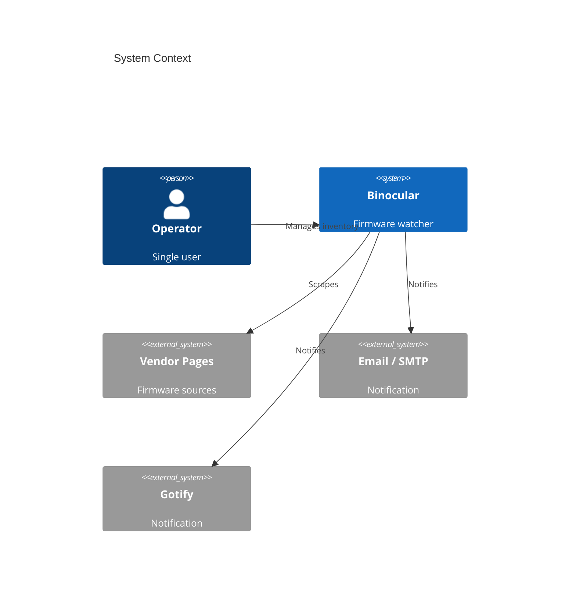
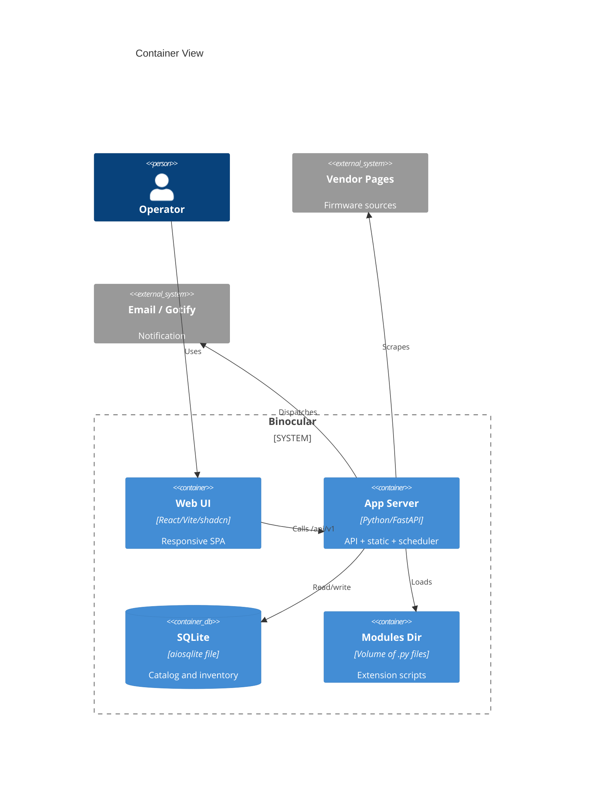
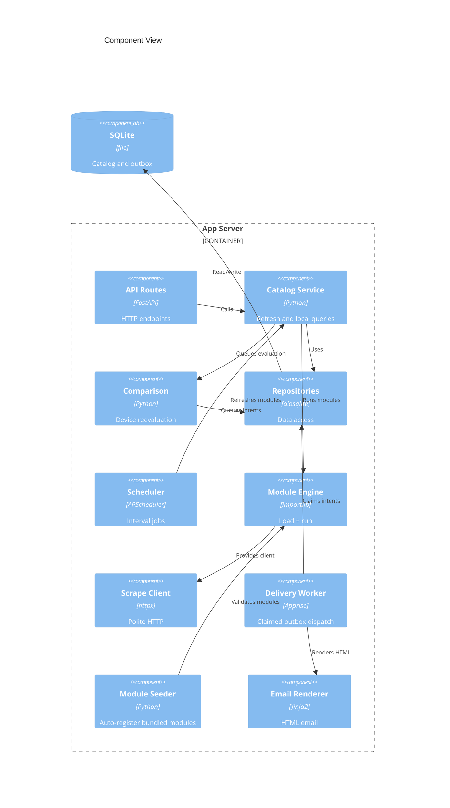
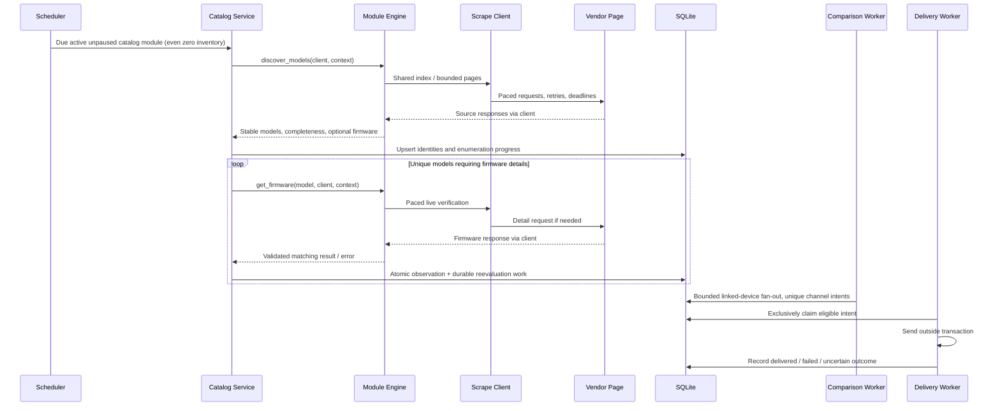
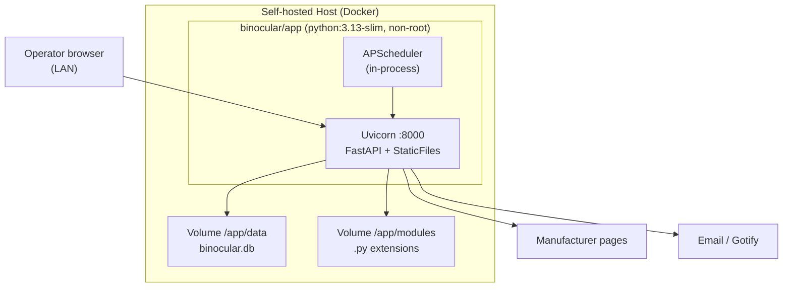

# Software Architecture Document: Binocular

> Date: 2026-10-29 | Status: Draft

## Purpose and Scope

Binocular is a self-hosted, single-user firmware watcher for **offline** devices. Its target architecture separates manufacturer discovery from owned-device monitoring: active catalog-capable modules enumerate compatible models and verify firmware into a shared local SQLite catalog, independently of inventory. Owned devices reference those models and retain separate installed versions and notification state. Shared observations drive local comparison and alerts; Add Device and Modules browsing use the same local catalog and creation form. This amendment specifies future delivery, not completed runtime functionality.

The system boundary is a single deployable application running on a private, trusted LAN: one container exposing one HTTP port, persisting all state to one local data volume, with no external database, broker, account system, or cloud dependency. The architecture separates a stable **Core System** (inventory, scheduling, alerting, API, UI) from pluggable **Intelligence** (user-authored extension modules), so users extend device coverage without modifying core code.

## Technical Context

**Language/Version**: Python 3.13+ (backend); TypeScript 5.x / React 19 (frontend)  
**Primary Dependencies**: FastAPI, Uvicorn, aiosqlite, Pydantic, APScheduler, Apprise, httpx, structlog, Jinja2, BeautifulSoup4 (backend); React, Vite, Tailwind CSS 4.x (CSS-first config via `@tailwindcss/vite`), shadcn/ui, Radix UI primitives, React Router, TanStack Query, React Hook Form, class-variance-authority, clsx, tailwind-merge, tw-animate-css, lucide-react (frontend)  
**Storage**: SQLite single file (`binocular.db`) via aiosqlite with raw SQL and a numbered-migration runner; no ORM, no external DB server  
**Testing**: pytest + pytest-asyncio, httpx.AsyncClient and MockTransport, injected monotonic clocks/sleepers (backend); Vitest + React Testing Library, one Playwright smoke test (frontend); golden/fixture-based module correctness and integration tests, including multi-page Canon catalogue/product/firmware flows
**Target Platform**: Linux Docker container (`python:3.13-slim`), single port 8000; also runnable directly on a host with Python/Node runtimes  
**Project Type**: Web application — Python/FastAPI backend + React SPA, single-process monolith  
**Performance Goals**: Database-only catalog search/browse with default 50/max 100 results and bounded rendered windows against 10,000-model fixtures; no vendor requests from form/browse interaction. Background refresh shares indexes and verifies each unique compatible model once per refresh scope, with bounded fair batches and centralized pacing. Canon warm single-model verification is one live request (0-30 seconds without competing work); cold discovery may take 90-120 seconds, not a whole-catalog deadline.
**Constraints**: Self-contained storage (no external DB), single-container/single-volume/zero-config/non-root operability, trusted-LAN single-user, no telemetry, polite-scraping mandatory, bounded cancellation-safe check execution, existing budgets preserved for origins without a longer valid crawl delay, unsandboxed extension execution
**Scale/Scope**: Single user/instance; roughly 5–50+ owned devices but potentially thousands of unowned catalog models; one scheduler concurrent with bounded catalog reads, refresh, comparison, and delivery work

## System Scope and Context

Primary actor is the **self-hosting operator** (also the sole user). External systems are **manufacturer firmware pages** (scrape targets), and the **notification channels** Email/SMTP and Gotify. Module authors interact indirectly by supplying extension modules; there is no external account provider or cloud backend.

### C4 System Context

### C4 Container View

### C4 Component View

## Solution Strategy and Architecture Style

- **Single-container monolith**: FastAPI backend serves the React SPA as static files, runs the scheduler in-process, and persists to a single SQLite file. One port, one image, trivial backup.
- **Core/Extension separation**: Modules enumerate source models and verify firmware; the host owns stable catalog identity, persistence, refresh scheduling, comparison, and alerts. Explicit V2 capability negotiation coexists with labeled non-enumerating V1 checking. Modules remain unsandboxed/in-process and use the host client. See {SAD:ADR-0016}.
- **Catalog/Inventory separation**: Instance-local models and timestamped observations serve all physical devices and both onboarding entry points. “Global” never means cross-instance/cloud storage. Local reads never execute modules; explicit refresh/check actions enqueue background work. See {SAD:ADR-0015}.
- **Frontend component library strategy**: The SPA uses **shadcn/ui** (New York style, Zinc-based neutral palette with blue primary accent) as the canonical component library from day one. shadcn/ui provides composable, accessible primitives built on Radix UI. Styling uses Tailwind CSS v4's CSS-first configuration model (`@tailwindcss/vite` plugin). Dark mode uses `@custom-variant dark (&:is(.dark *))`. Utility composition via `cn()` helper (clsx + tailwind-merge). Components organized as: `components/ui/` (shadcn primitives), `components/inventory/`, `components/logs/`, `components/modules/`, `components/settings/`, `components/layout/`.
- **Source Code Location**: All project source code resides under `/src` within each application root — backend code under `backend/src/` and frontend code under `frontend/src/`.
- **Why this style fits**: It is the only style that satisfies the self-hosted, zero-infrastructure, single-volume, set-and-forget constraints while keeping the user-extensibility seam explicit.
- **Alternatives considered**: Microservices/multi-container (rejected — disproportionate operational overhead for one user) and serverless/cloud (rejected — violates self-hosted, offline-LAN, data-ownership constraints). Captured in {SAD:ADR-0001}.

## Key Runtime Flows and Failure Paths

### Primary Flow — Shared Catalog Refresh

### Local Browsing, Creation, and Reevaluation

Add Device selects a module then searches local display names/aliases using a labeled keyboard-accessible combobox. Modules searches/browses the same paged model API, including unowned models, and shows latest known firmware, verification/freshness, relevant source links/status, and inventory count. “Add to inventory” opens the shared form with module/model preselected; count never blocks a second physical copy. Both flows save stable model UUID, ask for name and installed version or explicit unknown, and never default installed firmware from the latest observation.

Opening, typing, selecting, pagination, and loading empty/stale/error states are DB-only. Both surfaces distinguish local loading, no discovered models, no search matches, stale/paused data, failed/partial refresh, and legacy unsupported-catalog capability. Explicit Refresh/Retry enqueues a job and exposes local progress; it is not an implicit effect of opening the UI. Preserve canonical source links and separate consumer-help guidance. Shared validation rejects cross-module model IDs and unresolved/ambiguous identities; accessible labels, active-option state, keyboard navigation, Escape, and announced loading/results/errors follow the WAI-ARIA combobox pattern.

Creating a device, editing installed firmware, or confirming an update atomically saves its revision and queues the same local comparison used by successful refresh fan-out. Confirmation submits the displayed target version/observation ID and expected device revision, not an unseen newer result. Unknown installed/incomparable versions are not current; failed/stale knowledge remains informational until fresh successful verification. Obsolete unsent alerts are superseded, while delivered history remains intact. See {SAD:ADR-0017}.

### Failure Paths

- Module raises / times out → per-invocation Exception/SystemExit boundary and bounded cooperative client cancellation record a visible failed/partial run; other modules and the core continue. Unsandboxed Python is not forcibly contained by a timed-out thread. See {SAD:ADR-0016}.
- Vendor page changed / unparseable → module returns no version or errors → surfaced as a visible "scrape failed" status with last-success timestamp; never a silent miss.
- Vendor returns 429/5xx → every retry re-enters shared per-origin pacing and exponential backoff within the caller's end-to-end deadline; persistent failure logged. See {SAD:ADR-0012}.
- Source declares a valid `Crawl-delay` longer than the conservative default → the effective per-origin interval increases automatically and bounded multi-request budget accommodation applies; missing, invalid, or shorter declarations leave default pacing and budgets unchanged.
- Fresh Canon endpoint mapping → one live model verification through `ScrapeClient`, sharing the 30-second Canon origin timeline. Verified firmware becomes a provenance-bearing local observation; reading it is not a live check. Warm single-model work is 0-30 seconds without contention; queued full catalogs can take longer.
- Canon endpoint mapping expired after 24 hours or missing → bypass it and perform the full catalogue → product → firmware discovery flow, which may take 90-120 seconds under Canon pacing. A cached endpoint transport, status, parsing, or model-identity failure invalidates the mapping, then permits one full discovery attempt; if recovery cannot produce a live result, the check visibly fails with its last-success timestamp intact.
- Concurrent checks/refreshes for one compatible model → coalesce live work; distinct models share reusable indexes where possible and the origin pacing timeline. Stored observations permit local comparison without network calls; only successful live validation advances verification time.
- Check times out or is cancelled during robots lookup, pacing, backoff, redirect handling, or I/O → pending waits and retries stop, cancellation propagates after cleanup, and no subsequent background request is issued. See {SAD:ADR-0012}.
- Failed/partial enumeration → preserve prior models and observations without inventing completeness; only a complete authoritative scan may mark a model missing, retaining referenced rows. Per-model firmware failures retain original verified timestamps and a visible failed status; discovery success alone is not firmware success.
- Notification failure → observation stays persisted; definite channel failures retry through the same durable intent without resending successful channels. Ambiguous acceptance becomes visible `uncertain`, requiring explicit warned retry, never automatic replay.
- Repeated/concurrent evaluation → unique device/canonical-version/channel intents and exclusive claims suppress duplicate enqueue/dispatch. Only newer-than-installed and newer-than-that-channel's-delivered versions qualify. A compatibility `last_notified_version` projection cannot suppress another failed channel. No external exactly-once delivery claim is made.
- SQLite lock contention → `busy_timeout` (5s) wait; WAL allows concurrent reads during scheduler writes. See {SAD:ADR-0004}.
- Malformed module upload → rejected pre-save by two-phase validation (static AST + optional runtime proof) with structured per-phase results; never enters the modules directory. Validation errors are formatted for AI-friendly copy-paste.
- Official module consistently failing → module refresh health, including zero-inventory runs, alerts the operator (CAP-014); explicit no-firmware is not a scraper failure.

## Deployment and Infrastructure View

A multi-stage Docker build compiles the Vite frontend in a Node stage and copies `dist/` into the Python image, which serves it via FastAPI `StaticFiles` with an SPA catch-all — single port, single image. Two volumes (`/app/data`, `/app/modules`) hold all mutable state. The container runs as a non-root user with configurable UID/GID via `PUID`/`PGID` entrypoint; a `HEALTHCHECK` validates liveness. See {SAD:ADR-0001}, {SAD:ADR-0003}.

## Cross-Cutting Concerns

### Security

Trusted-LAN, single-user model: no authentication by default, with optional basic-auth middleware; exposure to untrusted networks remains unsupported. Extension modules execute in-process with **no sandbox** — an explicit arbitrary-code-execution trust boundary mitigated (not eliminated) by non-root PUID/PGID execution and operator vetting. Secrets load via environment variables / `_FILE` Docker-secret patterns and are never hardcoded; raw SQL uses parameterized queries exclusively. See {SAD:ADR-0008}, {SAD:ADR-0016}.

### Reliability

APScheduler reconstructs jobs from module controls and negotiated capabilities, independent of inventory count. Missed windows coalesce rather than replay. Persist refresh generations/cursors/leases, bounded fan-out, and delivery state; fence obsolete completions and resume valid work after restart without resetting exhausted budgets indefinitely. Source-aware deadlines, shared normalized-origin pacing/backoff, and cancellation follow ADR-0012, preserving unaffected origins' budgets. Automatic pause is module-wide; explicit manual refresh remains available. Failed refreshes never inflate freshness. See {SAD:ADR-0015}, {SAD:ADR-0017}.

### Observability

Structured `structlog` events include module/model/run/device/delivery/attempt identifiers across migration, local queries, refresh phases, comparison, and dispatch. Expose separate enumeration and firmware attempt/last-success timestamps, partial progress, stale/paused state, retryable failures, and uncertain deliveries. Logs emit to stdout/stderr plus a bounded SQLite activity view; no external telemetry.

### Data Management

All state remains in `binocular.db` on `/app/data`; use a live-safe SQLite backup, not a lone raw-file copy under WAL writes. Append-only numbered migrations run at startup after the mandatory pre-migration snapshot, with `schema_version` tracking, WAL, `foreign_keys=ON`, and bounded `busy_timeout`. Catalog observations and durable work are backed up with inventory; activity/attempt history is bounded without deleting referenced identities or required deduplication history. See {SAD:ADR-0004}, {SAD:ADR-0015}, {SAD:ADR-0017}.

| Entity | Identity and state | Relationships / invariants |
|--------|--------------------|----------------------------|
| CatalogModel | Internal stable UUID; unique module/source model key/canonical variant; name, aliases/source IDs, region/mount/hardware revision, source/product/help links, active/missing status, last-seen/enumeration metadata | Independent of inventory; renames preserve UUID; never merge compatibility variants or fabricate from inventory text |
| FirmwareObservation | Matching model ID, verified version or authoritative no-firmware, release links/date, provenance, verified_at, observation generation | Latest successful observation persists separately from last attempt/error; failure never advances verified_at |
| Device | Existing ID/module_id; catalog_model_id, independent name/installed version or explicit unknown, optimistic revision | Many devices per model; model must belong to module; nullable model only for labeled V1/unresolved migration |
| CatalogRefreshRun / work | Module/config generation, requested scope, cursor, completeness, attempts/last success, finite budget, bounded lease/progress | Coalesces overlapping jobs; source controls persist; partial scans cannot delete identities |
| ReevaluationWork | Model/observation generation or device revision, durable bounded fan-out cursor | Saved atomically with observation or device mutation; idempotent chunks cannot lose concurrent additions |
| NotificationIntent / attempt | Unique device/canonical-target-version/channel; pending/sending/delivered/failed/uncertain/superseded, claim token/generation, attempt evidence | Preserve channel delivery history/watermarks; exclusive dispatch, no successful-channel resend; stale workers cannot finalize |
| SourceEndpointMapping | Source model/variant endpoint identity, discovered_at, validation/invalidation metadata | Separate less-than-24-hour validity, same-model coordination, and one live full-discovery recovery |

Observation freshness is `age < module refresh interval` (default daily); at the interval boundary it is stale. Pause is explicit scheduling status, not invalidation of a still-fresh successful observation; successful manual verification while paused uses normal comparison/alert semantics. Stale/failed model verification cannot establish new current/alert claims. Successful models in a partial module run retain their own successful verification/freshness independently of failed units. Endpoint validity remains `age < 24 hours`, independent of observation age.

Inventory migration preserves IDs/names/installed versions, notification history, module IDs, frequency, and pause. Backfill only exact uniquely verified compatible identities; ambiguous/unresolved rows require model selection and retain legacy checking only if that checker truly exists. Compatible module updates preserve keys/FKs; capability downgrades require visible handling. Block deletion of inventory-referenced modules unless inventory is explicitly reassigned; retain missing catalog models while referenced.

### Write Ownership and Delivery Consistency

Before atomic catalog/fan-out/outbox delivery, replace independently committing writes on the shared lifespan connection with caller-owned units of work using dedicated write connections. Participating repositories never commit independently; all scheduler/cache/device/notifier writers follow the ownership boundary. Do not add a competing lock around the old shared connection. Network I/O is always outside bounded transactions. Persist observation plus reevaluation work atomically, then drain fan-out in bounded transactions that insert unique eligible delivery intents and advance the cursor together. Device mutations similarly commit revision plus reevaluation. See {SAD:ADR-0017}.

Claims use durable tokens/generations and compare-and-set transitions; recheck current revision/eligibility immediately before sending. Lease expiry does not permit a second dispatcher while the prior sender could still run. Definite failures can retry with bounded backoff; interrupted/ambiguous sends become uncertain, not automatically pending. Record accepted-send evidence even when a concurrent installed-version change makes the evaluation obsolete. SMTP/Gotify acceptance is not guaranteed human receipt or universal exactly-once delivery; explicit retries of uncertain outcomes warn of duplicate risk.

### Integration Strategy

Outbound manufacturer scraping uses the host-provided HTTP client, enforcing robots.txt, identifiable User-Agent, shared per-origin pacing, source-declared crawl delays, bounded retries/backoff, and cancellation. Apprise dispatches responsive light-themed HTML Email/SMTP and Gotify from claimed intents. No external catalog service or inbound integration is added. See {SAD:ADR-0012}, {SAD:ADR-0017}.

The Canon integration retains two independent modules and one shared Canon origin: exact EOS R cameras and classified RF/RF-S lenses from Canon Asia English. Enumeration reuses catalogue responses; detail verification follows product links verbatim, discovers firmware form actions, and deduplicates OS packages into releases. Endpoint mappings persist lookup metadata only and expire at exactly 24 hours; cached-endpoint transport/status/parsing/identity failure invalidates them and permits one full paced discovery fallback. Firmware lives separately as verified catalog observations, not inside the endpoint mapping. A warm live model verification needs one request, regardless of owned copies; reading its local observation needs none. Shared index/detail work is coalesced without bypassing the Canon 30-second origin pacing, deadlines, or cancellation. Cold model discovery may take 90-120 seconds; whole catalogs use bounded resumable work rather than a single-model timeout promise. Keep official release links, exact identity, and visible unknown/no-firmware/structural errors distinct. Cinema EOS/EOS R5 C, cinema lenses, adapters, extenders, unrelated mounts, regional fallback, and firmware-binary retrieval remain excluded. RF-S catalogue membership does not imply a positive firmware release was verified. See {SAD:ADR-0015}.

### Module Contract and Local API Boundaries

`MODULE_VERSION` is the author's revision; protocol negotiation uses integer `MODULE_API_VERSION` plus `MODULE_CAPABILITIES`. Missing protocol or explicit `1` selects unchanged V1 `check_firmware(url, model, http_client)` with labeled manual entry/per-model checks, never enumeration. V2 catalog support requires explicit `2` and `"catalog"`; unsupported/malformed declared versions or contradictory capability declarations fail visibly. Preserve optional source guidance and `SOURCE_URL`. Required V2 entrypoints and result semantics are defined by {SAD:ADR-0016}:

| Contract | Host-validated meaning |
|----------|------------------------|
| `discover_models(http_client, context) -> CatalogPage` | Stable source keys/compatible variants, display names/aliases/source IDs/links, explicit continuation/completeness; optional validated inline firmware when the same authoritative response verifies it |
| `get_firmware(model, http_client, context) -> FirmwareResult` | Matching model/variant, verified version or authoritative no-firmware, provenance/date/release links; supports per-model details when enumeration has no firmware |
| Host refresh context | Scoped shared-index/response reuse, bounded continuation, deadline/cancellation; no dependency on owned inventory or independent networking |

AST validation checks the declared contract and required signatures; optional runtime proof exercises enumeration/completeness, variants, inline/detail results, and visible failures. Existing V1 custom modules remain accepted; docs/README, validator/harness, templates/examples, all official modules, and AI Module Kit must migrate coherently. Recommended custom migration: verify source enumeration, establish stable variant keys, split shared discovery/details, add fixtures, then explicitly declare V2/catalog while updating the same installed module ID. Unresolved migrated inventory can use an actually retained V1 checker; otherwise show needs-model-selection, never invent fallback capability.

| API surface | Boundary |
|-------------|----------|
| `GET /api/v1/modules/{id}/models?q=&cursor=&limit=` | DB-only name/alias search, default 50/max 100 items, deterministic cursor order, inventory counts, latest observation/freshness/attempt/source status, explicit complete/empty/legacy state |
| `GET /api/v1/modules/{id}/models/{model_id}` | DB-only selected identity and guidance; supports shared form preselection without downloading a full catalog |
| `POST /api/v1/modules/{id}/catalog-refresh` | Explicit background refresh/retry, optional unique model scope; 202 plus run ID or existing coalesced run; manual refresh allowed while paused |
| `GET /api/v1/catalog-refreshes/{run_id}` | Local progress/completeness, per-model outcomes, stale/failed status, bounded errors |
| `/api/v1/devices` and confirmation | Shared stable-ID/module validation, independent installed/unknown, optimistic revision/explicit confirmation target, atomic local reevaluation |
| `/api/v1/checks` | Existing single/bulk actions normalize linked catalog devices to unique model background refreshes; V1 keeps explicit legacy per-model semantics |
| `/api/v1/checks/search-version` | Transitional explicit V1/per-model action only, not catalog dropdown/browse data source; catalog users use local observations and explicit refresh |
| Notification retry actions | Same durable intent/claim path; retry failed channel only, warn and require explicit action for uncertain outcomes |

### Operations

Distributed primarily as a Docker image (single port, two volumes, non-root with PUID/PGID configurable user via entrypoint, healthcheck), with a host-runtime fallback. Zero-config startup with sensible defaults; `BINOCULAR_DB_PATH` configurable. Dependencies pinned (lock file with hashes). A standalone module dev/test kit lets authors validate modules locally against the same polite HTTP client. A downloadable AI Module Kit (contract reference, starter template, working example, structured AI prompt) is served as static files by the backend.

## Quality Attributes

| Attribute | Target | Measurement | Notes |
|-----------|--------|-------------|-------|
| Performance | 10,000-model local queries/results and rendered windows bounded to max 100; zero vendor requests from UI reads; shared indexes and unique-model detail work | Request-count, pagination/render, and injected-time tests | Model-level Canon timings are not whole-catalog deadlines; all network work remains paced |
| Reliability | A broken, timed-out, or cancelled module never crashes the core or issues later background requests; no silent missed updates | Fault injection plus deterministic deadline/cancellation and fixture regression tests | End-to-end budget includes pacing and retries |
| Security | No hardcoded secrets; non-root container; parameterized SQL | Static analysis + image inspection | ACE trust boundary accepted by design |
| Maintainability | mypy --strict (backend) and tsc strict (frontend) pass; pinned deps | CI type-check + lint (Ruff/Biome) | Single-maintainer OSS |
| Scalability | Thousands of catalog models independent of inventory size; bounded refresh/fan-out/write transactions | 10,000-model fixtures, zero-inventory scheduler, restart/cursor tests | No horizontal scaling or cloud catalog |
| Correctness | Stable compatible identity, correct latest verification, unknown never current, no duplicate application dispatch from repeated/concurrent actions | Golden fixtures plus migration, freshness, variant, fan-out/revision/claim/channel tests | Last-known observations are not fresh live checks; no-firmware differs from errors; external delivery ambiguity remains explicit |
| Accessibility | Shared searchable combobox and paged Modules catalog work with keyboard and announced states | React/Playwright accessibility tests | Loading/empty/no-match/stale/failed/legacy and preselected creation covered |

## Architecture Decision Records

Project-level architectural decisions are maintained as standalone MADR files under `specs/adrs/`. This table is a navigational index — full decision records live in the linked files.

| ADR ID | Title | Status | Date | Supersedes | File |
|--------|-------|--------|------|------------|------|
| ADR-0001 | Self-hosted single-container monolith with core/extension separation | accepted | 2026-05-31 | — | [0001-self-hosted-single-container-monolith-with-core-extension-separation.md](adrs/0001-self-hosted-single-container-monolith-with-core-extension-separation.md) |
| ADR-0002 | Python 3.13 and FastAPI for the backend | accepted | 2026-05-31 | — | [0002-python-311-and-fastapi-for-the-backend.md](adrs/0002-python-311-and-fastapi-for-the-backend.md) |
| ADR-0003 | React + Vite + Tailwind SPA with shadcn/ui Component Library, served by FastAPI as static files | accepted | 2026-06-08 | — | [0003-react-vite-tailwind-spa-served-by-fastapi-as-static-files.md](adrs/0003-react-vite-tailwind-spa-served-by-fastapi-as-static-files.md) |
| ADR-0004 | SQLite file storage with aiosqlite and raw SQL (no ORM) | accepted | 2026-05-31 | — | [0004-sqlite-file-storage-with-aiosqlite-and-raw-sql-no-orm.md](adrs/0004-sqlite-file-storage-with-aiosqlite-and-raw-sql-no-orm.md) |
| ADR-0005 | Unsandboxed extension module engine with two-phase validation | superseded | 2026-05-31 | — | [0005-unsandboxed-extension-module-engine-with-two-phase-validation.md](adrs/0005-unsandboxed-extension-module-engine-with-two-phase-validation.md) |
| ADR-0006 | Centralized responsible-scraping HTTP client provided to modules | superseded | 2026-05-31 | — | [0006-centralized-responsible-scraping-http-client-provided-to-modules.md](adrs/0006-centralized-responsible-scraping-http-client-provided-to-modules.md) |
| ADR-0007 | In-process scheduling with APScheduler and Apprise notifications with notification deduplication | superseded | 2026-06-07 | — | [0007-in-process-scheduling-with-apscheduler-and-apprise-notifications.md](adrs/0007-in-process-scheduling-with-apscheduler-and-apprise-notifications.md) |
| ADR-0008 | Trusted-LAN single-user security model with optional basic auth | accepted | 2026-05-31 | — | [0008-trusted-lan-single-user-security-model-with-optional-basic-auth.md](adrs/0008-trusted-lan-single-user-security-model-with-optional-basic-auth.md) |
| ADR-0009 | Module-Derived Device Type — Remove Standalone Device Type Field, Derive from Linked Module | accepted | 2026-06-04 | — | [0009-module-derived-device-type-remove-standalone-device-type-field.md](adrs/0009-module-derived-device-type-remove-standalone-device-type-field.md) |
| ADR-0010 | Environment-Variable Based Configuration and Database Seeding | accepted | 2026-06-12 | — | [0010-environment-variable-based-configuration-and-database-seeding.md](adrs/0010-environment-variable-based-configuration-and-database-seeding.md) |
| ADR-0011 | Real-Time Module Validation and Upload Progress Streaming | accepted | 2026-06-12 | — | [0011-real-time-module-validation-and-upload-progress-streaming.md](adrs/0011-real-time-module-validation-and-upload-progress-streaming.md) |
| ADR-0012 | Source-aware centralized scraping with shared per-origin pacing and bounded cancellation | accepted | 2026-09-06 | ADR-0006 | [0012-source-aware-centralized-scraping-with-shared-per-origin-pacing-and-bounded-cancellation.md](adrs/0012-source-aware-centralized-scraping-with-shared-per-origin-pacing-and-bounded-cancellation.md) |
| ADR-0013 | Module-Declared Source URL for Device-Creation Lookup | accepted | 2026-09-07 | — | [0013-module-declared-source-url-for-device-creation-lookup.md](adrs/0013-module-declared-source-url-for-device-creation-lookup.md) |
| ADR-0014 | Persisted Canon firmware endpoint discovery cache | superseded | 2026-09-07 | — | [0014-persisted-canon-firmware-endpoint-discovery-cache.md](adrs/0014-persisted-canon-firmware-endpoint-discovery-cache.md) |
| ADR-0015 | Instance-local model catalog and verified firmware observations | accepted | 2026-10-29 | ADR-0014 | [0015-instance-local-model-catalog-and-verified-firmware-observations.md](adrs/0015-instance-local-model-catalog-and-verified-firmware-observations.md) |
| ADR-0016 | Versioned catalog-capable module contract with V1 compatibility | accepted | 2026-10-29 | ADR-0005 | [0016-versioned-catalog-capable-module-contract-with-v1-compatibility.md](adrs/0016-versioned-catalog-capable-module-contract-with-v1-compatibility.md) |
| ADR-0017 | Shared model refresh with transactional comparison and notification delivery | accepted | 2026-10-29 | ADR-0007 | [0017-shared-model-refresh-with-transactional-comparison-and-notification-delivery.md](adrs/0017-shared-model-refresh-with-transactional-comparison-and-notification-delivery.md) |

<!-- Rows are managed by the ADR Author subagent. Do not embed full decision prose here. -->

## Risks, Assumptions, Constraints, and Open Questions

### Risks

- Unsandboxed extension modules run with host privileges — accepted ACE trust boundary; mitigated by non-root execution and operator vetting only.
- Manufacturer page changes break scrapers — highest operational risk; mitigated by visible failure status rather than silent misses.
- False negatives (missed updates) are invisible without telemetry — mitigated by fixture-based correctness validation at release.
- Notification-channel misconfiguration/outage goes unnoticed — mitigated by activity-log visibility.
- Scheduler shares the app process lifecycle — a restart pauses jobs until the next interval.
- Very long source-declared crawl delays can prevent a multi-request check from completing inside its finite cap — mitigated by visible bounded failure rather than violating source pacing.
- Canon Asia catalogue taxonomy, product links, form actions, or firmware fragments can drift independently — mitigated by captured fixtures for each stage, exact matching, and visible structural failures rather than inferred coverage.
- Cached Canon endpoint metadata can expire or drift — mitigated by 24-hour freshness, invalidation on endpoint failure, one paced full-discovery fallback, and visible failure rather than stale result reuse.
- Catalog growth and unowned sources increase outbound work — mitigate with shared indexes, bounded fair batches, resumable progress, module-wide controls, and independent local UI reads.
- Name/alias-only backfill can link incompatible hardware — require exact verified identity or visible unresolved migration; preserve variant distinctions.
- Mixed SQLite commit ownership can break atomic fan-out/deduplication — require the coherent write-ownership prerequisite before enabling transactional work; no network inside transactions.
- SMTP/Gotify timeout/crash can leave acceptance uncertain — do not auto-retry ambiguous sends or promise exactly-once; expose warned explicit retry.

### Assumptions

- Deployment is on a private, trusted LAN with a single user/operator.
- A persistent volume is available for `/app/data` and `/app/modules`.
- The operator has or can configure SMTP and/or Gotify for notifications.
- Manufacturer firmware pages remain publicly reachable and scrapable.
- Canon coverage is regional and catalogue-defined: Canon Asia English EOS R plus RF/RF-S only; Cinema EOS/EOS R5 C is not supported without a separately verified official flow, and no positive RF-S firmware release is assumed.

### Constraints

- No external database server; all persistence in a single SQLite file.
- Single container, single port, single data volume, non-root, zero-config startup.
- No telemetry or central data collection.
- Modules must use the host-provided HTTP client for all outbound scraping.
- The scraping client must preserve default pacing and execution budgets unless a longer valid source delay requires bounded accommodation, and timeout/cancellation must prevent subsequent requests.
- Endpoint mappings persist discovery metadata for less than 24 hours; verified firmware observations are separate local state with provenance and module-interval freshness. New successful verification always comes through the centralized client and invalid endpoint recovery stays visible.
- All catalog UI reads are local and bounded; latest available must not autofill installed firmware; unknown/incomparable/stale/failed cannot assert current.

### Open Questions

- None. All prototype-era open questions have been resolved.

## Project Context Baseline Updates

*Managed section — rewritten by SDD planning agents. Do not edit manually.*

- SQLite persistence uses an application-owned startup migration runner with append-only numbered SQL files, `schema_version` tracking, required connection pragmas, and a fatal pre-migration backup gate before pending migrations apply.
- Domain repositories use a shared raw-SQL repository base with parameter binding and allowlisted dynamic identifiers; no ORM abstraction is introduced.
- Responsible scraping uses a host-owned async `httpx` client wrapper with robots.txt checks, identifiable User-Agent defaults, and one normalized-origin pacing timeline shared by concurrent checks and every retry. The effective interval is the greater of the conservative default and a valid applicable source `Crawl-delay`; bounded source-aware end-to-end deadlines include pacing/backoff and propagate cancellation so no later background requests issue, while unaffected origins retain existing budgets. Deterministic tests inject monotonic timing and scripted transports. See {SAD:ADR-0012}.
- Extension modules use trusted in-process loading and two-phase validation, not a sandbox. ADR-0016 replaces V1-only contract policy with explicit V2/catalog negotiation and labeled V1 compatibility.
- Custom module uploads stream real-time validation progress updates (newline-delimited JSON events) to the frontend during the AST (Phase 1) and runtime (Phase 2) validation steps.
- The Modules page serves as the primary self-service onboarding path for module creation, with a "Create a Module" guidance section and a downloadable AI Module Kit (contract reference, starter template, working example, structured AI instructions) served as static backend assets. Validation error output includes an AI-friendly copy-paste feature.
- Bundled official starter modules are automatically discovered, validated, and seeded/upserted into the SQLite database on application startup.
- Device type remains module-derived under ADR-0009. Devices retain `module_id` and gain a matching `catalog_model_id` under ADR-0015, allowing multiple physical devices per stable compatible model; legacy/unresolved rows remain explicit.
- The application version is injected into the frontend bundle at Docker build time via a compile-time env var (populated from the latest git tag).
- Email notifications render as responsive HTML via Jinja2 templates with the application light color scheme.
- ADR-0017 extends per-device deduplication to durable unique canonical-version/channel intents, exclusive claims, and per-channel delivery history; `last_notified_version` is a compatibility projection, never the sole concurrency guard.
- Configuration settings for basic authentication (mapped from `BINOCULAR_AUTH_ENABLED`) and notification channels (SMTP and Gotify details/credentials) can be defined via environment variables. If present, they are automatically seeded and synced into the SQLite database at startup.
- `/api/v1/checks/search-version` remains a transitional explicit V1/per-model tool; catalog-capable creation and browsing use local models/observations plus explicit background refresh, never this live endpoint implicitly.
- Extension modules may declare an optional `SOURCE_URL` module-level constant naming the canonical source page they scrape. The loader extracts it (empty when absent), a `modules.source_url` column persists it, the modules API returns it, and the Add Device form renders it as a clickable link to help users look up exact model names. See {SAD:ADR-0013}.
- Canon official coverage is split into independently selectable camera and lens modules. Both use model-only exact catalogue lookup, verbatim product links, discovered firmware form actions, OS-package deduplication, official release-detail URLs, existing automatic seeding, visible failures, and ADR-0012's shared Canon-origin 30-second pacing with bounded timeout/cancellation. The verified baseline is Canon Asia English EOS R and RF/RF-S catalogues; Cinema EOS/EOS R5 C is explicitly unsupported pending a verified flow, and no positive RF-S firmware release is claimed.
- ADR-0015 supersedes ADR-0014's live-only version-storage restriction while retaining endpoint expiry/invalidation/fallback and Canon coverage boundaries. Firmware observations now persist separately; shared model verification remains live/paced, UI reads are local, and full catalogs use bounded resumable work.
- Source-display guidance is optional local metadata distinct from stable module identities and canonical scraped-source URLs. Legacy/custom V1 modules remain valid without new required declarations; human-help links do not introduce vendor requests for UI rendering.
- Source-wide frequency/pause govern catalog refresh even with no inventory; compatible updates/seeding preserve IDs/associations/controls. Manual actions remain distinct from automatic monitoring.
- Existing runtime writes commit per operation on a shared lifespan SQLite connection. Until ADR-0017's coherent caller-owned write-connection/unit-of-work refactor is delivered, do not layer multi-await transactions or independent locks over those commit boundaries. The refactor must include scheduler/check/cache/device/notifier participants before atomic observation, reevaluation, and outbox guarantees become active.
